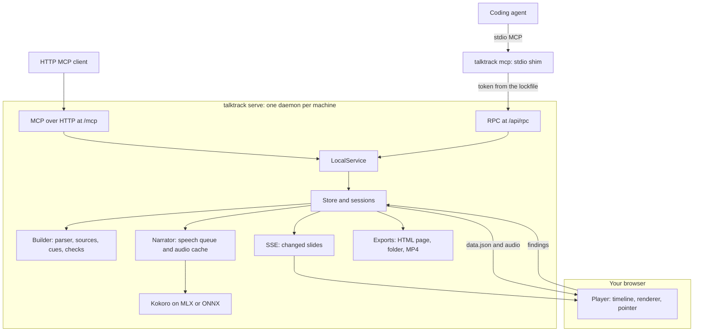
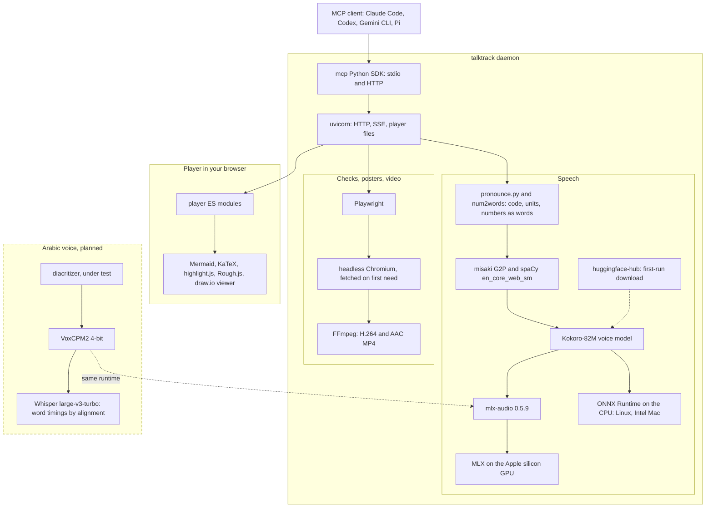

<div align="center">

# 🎙️ talktrack

**Narrated slide walkthroughs for coding agents, voiced on your machine.**
Your agent writes slides and narration in Markdown; talktrack voices them locally and hands back a link that starts playing while the rest is still being written.

[](CHANGELOG.md)
[](pyproject.toml)
[](LICENSE)

[Overview](#-overview) · [Architecture](#-architecture) · [Quick start](#-quick-start) · [Install per client](#-install-per-client) · [Format](#-the-format) · [Commands](#-commands) · [Limitations](#-status--limitations)

</div>

---

## 📖 Overview

Ask your agent to walk you through a pull request, a module or a concept, or to explain an article, a PDF, an image or an idea. It writes slides and narration in Markdown; talktrack voices them locally with [Kokoro](https://huggingface.co/hexgrad/Kokoro-82M) and hands back a link that starts playing in about a second, while the rest is still being written. A pointer follows the narration through code, diagrams and lists, word by word.


**[Watch the gallery](https://ahmedelhadarey.github.io/talktrack/)**: eleven walkthroughs written by Claude (Opus and Sonnet) and voiced on a laptop, unedited: a tour of this repository, a review of one commit, one call's path through it, a refactor step by step, CSRF and SameSite cookies, contributor setup, a speed-up told with a chart, the messages of an MCP tool call, the TLS 1.3 handshake, scaled dot-product attention, and git rebase versus merge on a phone-shaped frame.

### Highlights

- **Local:** speech runs on your Mac or PC. No API keys, no hosted service, no telemetry. Code never leaves your machine except to the model you already use.
- **Fast:** the link is playable about 0.3 s after the agent sends its opening, so you start watching while the agent keeps writing.
- **Grounded:** code slides are read straight from your files and git history, with real line numbers. The agent never retypes code, and the pointer lands on the right line.
- **Explains anything:** paste notes or an idea, or give an article link, a PDF or an image, and the `explain` prompt turns it into a walkthrough for the audience you name, such as "a grade-10 student". `read_source` gives the agent the source word for word, not a summary; a long document becomes a course.
- **Egyptian Arabic:** two designed Egyptian voices, `ar_eg_female` and `ar_eg_male`, on Apple silicon. The slides lay out right to left, and the reply names words whose reading depends on their meaning (مهمة: a task or important) so the agent adds the harakat. When you say a word sounds wrong, `add_pronunciation` fixes it in every walkthrough after.
- **Checked:** every call returns coded findings to the agent: a cue pointing at a missing line, code too big for the frame, narration that reads the screen aloud, a slide that holds still too long, and, from the player, diagrams that failed to render or text shrunk too small to read. `finish_walkthrough` draws every slide in headless Chromium to find them. The agent can also look at pictures of its slides with `preview_slides`.
- **Shareable:** export a walkthrough as one HTML file that plays offline (send it in Slack or by email), a static folder with captions, or an MP4; embed it with `<talktrack-player>`, link to a range of slides, or present it yourself with speaker notes. An agent in a sandbox or behind WhatsApp sends you the MP4 itself.

How it compares with a screen recording, a written PR description and a rendered MP4 explainer, including where those win: [docs/comparison.md](docs/comparison.md).

---

## 📑 Table of Contents

- [Architecture](#-architecture)
  - [Architecture diagram: the tool stack](#architecture-diagram-the-tool-stack)
- [Quick Start](#-quick-start)
- [Install per Client](#-install-per-client)
- [The Format](#-the-format)
- [MCP Tools, Prompts and Resources](#-mcp-tools-prompts-and-resources)
- [Commands](#-commands)
- [The Player](#-the-player)
- [Configuration](#-configuration)
- [Privacy and Security](#-privacy-and-security)
- [Project Structure](#-project-structure)
- [In Pull Requests (GitHub Action)](#-in-pull-requests-github-action)
- [Releasing](#-releasing)
- [Testing](#-testing)
- [Status & Limitations](#-status--limitations)
- [Documentation](#-documentation)
- [Contributing](#-contributing)
- [License](#-license)

---

## 🏗 Architecture

talktrack is one Python package and one static web player. A long-lived daemon owns the voice model and the walkthroughs. MCP clients reach it through a small stdio shim (`talktrack mcp`) or directly over HTTP.



**Request path:**

1. **Shim.** `talktrack mcp` reads `daemon.json` in the data folder. If no healthy daemon is running this code, it starts `talktrack serve` in the background and waits for `/health`. Its MCP tools forward to the daemon's RPC route with the token from the lockfile.
2. **Opening first.** The agent's first call, `start_walkthrough`, carries only the title slide and a sentence or two. It returns as soon as that audio exists, about 0.3 s later, and tells the agent to send you the link.
3. **Built as it arrives.** Each `add_slides` chunk goes through the incremental Markdown parser (`format.py`). The builder (`build.py`) turns blocks into slides, reads code from disk or git (`sources.py`), resolves and infers cues (`cues.py`) and records findings (`checks.py`), which go back on the same call.
4. **Voiced in the background.** Every narration paragraph becomes a speech job. `pronounce.py` rewrites code and units into speakable text. One worker thread voices jobs in order of their position in the walkthrough, and the audio is cached by a hash of model, voice, speed and spoken text. The player waits with a notice if it ever catches up with the writer.
5. **Live updates.** The SSE route coalesces changes for 50 ms and sends only the changed slides plus the slide order.
6. **Timed to the word.** Kokoro reports when each word is spoken. Each cue in the narration, a Markdown link like `[the retry limit](#L48)`, fires 0.3 s before its first word so the pointer lands as the word is heard.
7. **Checked.** `finish_walkthrough` draws every slide in headless Chromium (fetched on first need, below). The open player also posts its own findings (layout, render and audio errors) back to the daemon; they reach the agent marked as untrusted.

The module-by-module description, the player's ES modules, capture and single-page export are in [docs/architecture.md](docs/architecture.md).

### Architecture diagram: the tool stack

What talktrack is built on, from the agent down to the hardware. Everything outside the dashed box ships today; the dashed box is a planned Arabic voice that is not in talktrack yet.



| Layer | Tool | Why | License |
|---|---|---|---|
| Agent link | [MCP Python SDK](https://github.com/modelcontextprotocol/python-sdk), [uvicorn](https://github.com/encode/uvicorn) | tools, prompts and resources over stdio and HTTP; the player and live updates | MIT, BSD-3-Clause |
| Speakable text | [misaki](https://github.com/hexgrad/misaki), [spaCy](https://github.com/explosion/spaCy) with [en_core_web_sm](https://github.com/explosion/spacy-models), [num2words](https://github.com/savoirfairelinux/num2words) | English phonemes, sentence parsing, numbers as words | Apache-2.0, MIT, LGPL |
| Voice | [Kokoro-82M](https://huggingface.co/hexgrad/Kokoro-82M) via [mlx-community/Kokoro-82M-bf16](https://huggingface.co/mlx-community/Kokoro-82M-bf16) or [onnx-community/Kokoro-82M-v1.0-ONNX-timestamped](https://huggingface.co/onnx-community/Kokoro-82M-v1.0-ONNX-timestamped) | 27 English voices with word timings | Apache-2.0 |
| Runtime | [mlx-audio](https://github.com/Blaizzy/mlx-audio) on [MLX](https://github.com/ml-explore/mlx); [ONNX Runtime](https://github.com/microsoft/onnxruntime) | Apple silicon GPU; any CPU | MIT; MIT |
| Rendering | [Playwright](https://github.com/microsoft/playwright-python), [FFmpeg](https://ffmpeg.org/) | slide checks, posters, MP4 export | Apache-2.0; LGPL/GPL, installed by you |
| Player | [Mermaid](https://github.com/mermaid-js/mermaid), [KaTeX](https://github.com/KaTeX/KaTeX), [highlight.js](https://github.com/highlightjs/highlight.js), [Rough.js](https://github.com/rough-stuff/rough), [draw.io viewer](https://github.com/jgraph/drawio) | diagrams, formulas, code, sketches, draw.io files | MIT, MIT, BSD-3-Clause, MIT, Apache-2.0 |
| Arabic voice | [VoxCPM2](https://huggingface.co/openbmb/VoxCPM2) via [mlx-community/VoxCPM2-4bit](https://huggingface.co/mlx-community/VoxCPM2-4bit) | two designed Egyptian voices on the same mlx-audio, loaded on first use; word timings from the audio's pauses | Apache-2.0 |

Exact versions and licences of everything bundled are in [THIRD_PARTY_NOTICES.md](THIRD_PARTY_NOTICES.md).

---

## 🚀 Quick Start

### Prerequisites

- **[uv](https://docs.astral.sh/uv/).** It installs Python 3.12 or newer for you if needed.
- **Disk and network on first run:** the voice model (about 330 MB on Apple silicon, 92 MB elsewhere) and a 12 MB English language model. After that, everything works offline.
- **Chromium, fetched on first need:** the first slide check, poster or MP4 export downloads Playwright's headless Chromium (about 100 MB, 33 s on a fast line) with a progress line on stderr, and later runs reuse it. `TALKTRACK_AUTO_BROWSER=0` turns the download off.
- **Optional, for MP4 export:** [FFmpeg](https://ffmpeg.org/) (`ffmpeg` and `ffprobe`) on PATH.

### Install and connect

Every agent runs the same command, which starts talktrack as a stdio MCP server:

```zsh
uvx --from git+https://github.com/AhmedElhadarey/talktrack@v0.2.0 talktrack mcp
```

The tag after `@` installs that release; leave it off for the latest commit. Once talktrack is on PyPI this shortens to `uvx talktrack mcp`. Pick your agent under [Install per client](#-install-per-client), then ask it something like *"walk me through how a request gets retried in this codebase"*. The agent replies with a link; open it and press play.

The first walkthrough takes a few seconds longer while the models load.

The browser that draws slides comes with the first need for it: the first `finish_walkthrough`, poster or MP4 export downloads Playwright's headless Chromium (about 100 MB) once, and `talktrack doctor` says whether it is there yet. Where the download fails (offline, or a Linux image without the system libraries) the reply names the commands to run by hand:

```zsh
uvx --from git+https://github.com/AhmedElhadarey/talktrack@v0.2.0 playwright install chromium-headless-shell
uvx --from git+https://github.com/AhmedElhadarey/talktrack@v0.2.0 playwright install --with-deps chromium-headless-shell-headless-shell   # Linux, as root: also the system libraries
```

Installs made with `talktrack[video]` keep working; the extra is empty now.

Or paste this into your agent and let it set itself up:

```text
Install talktrack, an MCP server that turns Markdown into narrated slide walkthroughs voiced on this machine: https://github.com/AhmedElhadarey/talktrack

1. If `uv` is missing, install it: curl -LsSf https://astral.sh/uv/install.sh | sh
2. Add a stdio MCP server named talktrack to your own MCP configuration, for all my projects, with this command:
   uvx --from git+https://github.com/AhmedElhadarey/talktrack@v0.2.0 talktrack mcp
3. Run `uvx --from git+https://github.com/AhmedElhadarey/talktrack@v0.2.0 talktrack doctor` and fix anything it marks with ✗. The first run downloads the voice model, a few hundred MB.
4. Tell me whether I need to restart you or reload MCP servers before the tools appear. Once they do, make a three-slide walkthrough of this project and send me the link.
```

### Run locally

From a checkout, without a voice model:

```zsh
uv sync
uv run pytest -m "not slow and not browser and not mlx and not onnx"   # fast tests, no models or browser
uv run talktrack serve --speech fake                                   # run without a voice model
```

You can also write a walkthrough by hand and play it with `talktrack play talk.md`.

### Run the tests

The first command in the block above runs the fast tests. The rest of the suites are under [Testing](#-testing).

---

## 🔌 Install per Client

### Claude Code

1. Add the server for all your projects:

   ```zsh
   claude mcp add --scope user talktrack -- uvx --from git+https://github.com/AhmedElhadarey/talktrack@v0.2.0 talktrack mcp
   ```

2. Start a new `claude` session and run `/mcp`; `talktrack` should be listed as connected.
3. Ask for a walkthrough, or use a built-in prompt: `/mcp__talktrack__diff HEAD~1..HEAD`, `/mcp__talktrack__file src/app.py`, `/mcp__talktrack__feature how login works` or `/mcp__talktrack__topic how TLS works`.

**Or install the plugin** instead of step 1. You get the MCP server plus a skill: guidance on when a walkthrough beats a written answer, and how to pace one:

```zsh
claude plugin marketplace add AhmedElhadarey/talktrack
claude plugin install talktrack@talktrack
```

Claude Code 2.1.275 or later does both in one step: `claude plugin install talktrack --marketplace AhmedElhadarey/talktrack`. Check it with `claude plugin list`. A new release arrives with `claude plugin marketplace update talktrack` and then `claude plugin update talktrack@talktrack`. Use the plugin or `claude mcp add`, not both, or Claude sees two copies of the tools.

### Codex CLI

1. Add the server (this writes `~/.codex/config.toml`):

   ```zsh
   codex mcp add talktrack -- uvx --from git+https://github.com/AhmedElhadarey/talktrack@v0.2.0 talktrack mcp
   ```

2. Check it with `codex mcp list`, or run `/mcp` inside a `codex` session.
3. Start `codex` in your project and ask for a walkthrough.

If you prefer to edit the config file yourself, add:

```toml
[mcp_servers.talktrack]
command = "uvx"
args = ["--from", "git+https://github.com/AhmedElhadarey/talktrack@v0.2.0", "talktrack", "mcp"]
```

### Antigravity CLI (agy)

1. Add the server (this writes `~/.gemini/config/mcp_config.json`, which the Antigravity IDE shares). Flags go before the name, and the `--` keeps `--from` from being read as an agy flag:

   ```zsh
   agy mcp add talktrack -- uvx --from git+https://github.com/AhmedElhadarey/talktrack@v0.2.0 talktrack mcp
   ```

2. Check it with `agy mcp list`.
3. Start `agy` in your project and ask for a walkthrough. MCP tools ask for approval by default, so allow talktrack's tools when prompted. In print mode there is no prompt, so the calls may be refused.

### Gemini CLI

1. Install the extension. It adds the server and a context file ([GEMINI.md](GEMINI.md)) with the same guidance as the Claude Code skill:

   ```zsh
   gemini extensions install https://github.com/AhmedElhadarey/talktrack
   ```

2. Check it with `gemini extensions list`, or run `/mcp` inside a `gemini` session.
3. Start `gemini` in your project and ask for a walkthrough. Update later with `gemini extensions update talktrack`.

### Pi

Recent Pi (checked with 1.3.0) has MCP built in.

1. Add the server (this writes `~/.pi/agent/mcp.json`; add `-l` to write `.pi/mcp.json` in the current project instead):

   ```zsh
   pi mcp add talktrack -- uvx --from git+https://github.com/AhmedElhadarey/talktrack@v0.2.0 talktrack mcp
   ```

2. Check it with `pi mcp list`. It should say `talktrack: connected, 7 tools`.
3. Start `pi` in your project and ask for a walkthrough.

Older Pi without `pi mcp` needs the [pi-mcp-adapter](https://github.com/nicobailon/pi-mcp-adapter) extension instead. Run `pi install npm:pi-mcp-adapter`, then put this in `~/.config/mcp/mcp.json`:

```json
{
  "mcpServers": {
    "talktrack": {
      "command": "uvx",
      "args": ["--from", "git+https://github.com/AhmedElhadarey/talktrack@v0.2.0", "talktrack", "mcp"]
    }
  }
}
```

### Other clients

- **VS Code:** add the server to your user profile from a terminal, then pick `talktrack` under **MCP: List Servers**:

  ```zsh
  code --add-mcp '{"name":"talktrack","command":"uvx","args":["--from","git+https://github.com/AhmedElhadarey/talktrack@v0.2.0","talktrack","mcp"]}'
  ```

- **GitHub Copilot CLI:** its plugin system reads the same marketplace file as Claude Code: `copilot plugin marketplace add AhmedElhadarey/talktrack`, then `copilot plugin install talktrack@talktrack`.
- **Cursor, Claude Desktop and others:** add a stdio server with command `uvx` and arguments `--from git+https://github.com/AhmedElhadarey/talktrack@v0.2.0 talktrack mcp`. Most use the same `mcpServers` JSON as the older-Pi example.
- **Over HTTP:** run `uvx --from git+https://github.com/AhmedElhadarey/talktrack@v0.2.0 talktrack serve` and connect the client to `http://localhost:4747/mcp`.

### Agents in a sandbox or a chat app

When the agent runs in a sandbox, or you talk to it through WhatsApp, Telegram or similar, a `localhost` link is no use to you. Run the server with `--deliver file`: the agent then writes the whole walkthrough, calls `export_walkthrough`, and sends you the MP4 instead of a link.

```zsh
# inside the sandbox image, once (Debian or Ubuntu); Chromium would download on first use, its system libraries would not
apt-get install -y ffmpeg
uvx --from git+https://github.com/AhmedElhadarey/talktrack@v0.2.0 playwright install --with-deps chromium-headless-shell
# the MCP server the agent runs
uvx --from git+https://github.com/AhmedElhadarey/talktrack@v0.2.0 talktrack mcp --deliver file
```

| Part | What happens |
|---|---|
| **Where it runs** | inside the sandbox, beside the agent, so the file lands where the agent can attach it; a server on the host would write outside the agent's reach |
| **File** | an MP4 named after the title in the project folder, or `path` |
| **Size** | kept within 16 MB, WhatsApp's video limit, by lowering the audio bitrate and then the picture to 720p; the agent passes `max_mb` for other apps (Telegram bots 50, Signal 100). Narration is most of the size: a 3.5-minute walkthrough is about 4 MB |
| **Frame** | the agent is told you are likely on a phone, so it picks portrait or square unless the code is wide |
| **Checks** | `talktrack doctor` says whether ffmpeg and Chromium are there |

To set it up, paste this into the agent:

```text
Install talktrack, an MCP server that turns Markdown into narrated slide walkthroughs: https://github.com/AhmedElhadarey/talktrack
I can't open links on your machine, so you'll send me walkthroughs as MP4 files.

1. Install what's missing in your environment: uv (curl -LsSf https://astral.sh/uv/install.sh | sh) and ffmpeg with ffprobe (apt-get install -y ffmpeg, your package manager, or a static build on PATH).
2. Install Chromium and its system libraries for video rendering ahead of time:
   uvx --from git+https://github.com/AhmedElhadarey/talktrack@v0.2.0 playwright install --with-deps chromium-headless-shell
   If you can't install system packages, drop --with-deps and tell me if Chromium fails to start.
3. Add a stdio MCP server named talktrack to your own MCP configuration, running inside this environment, not on a host outside it:
   uvx --from git+https://github.com/AhmedElhadarey/talktrack@v0.2.0 talktrack mcp --deliver file
4. Run `uvx --from git+https://github.com/AhmedElhadarey/talktrack@v0.2.0 talktrack doctor` and fix anything marked ✗ or about video export. The first run downloads the voice model, about 100 MB.
5. If this environment is rebuilt between sessions, add steps 1 to 3 to whatever sets it up, so they persist.
6. Once the tools appear (restart or reload MCP servers if you must), make a three-slide walkthrough on any topic, export it with export_walkthrough, and send me the MP4 as an attachment. If you have no way to attach files, tell me so instead of sending a path.
```

`TALKTRACK_DELIVER=file` does the same as the flag. In link mode the agent can still call `export_walkthrough` whenever you want an MP4 or a page to forward. To watch live links from your phone instead, serve over a private network such as Tailscale (or self-hosted Headscale) with `TALKTRACK_PUBLIC_URL`.

### Good to know

- **One shared daemon:** the first `talktrack mcp` starts a background daemon, and later ones reuse it. The voice model stays loaded and every agent shares one port. A newer copy of talktrack replaces an idle daemon running older code; an older copy uses the newer daemon as it is. `talktrack stop` stops it, and the next client starts its own.
- **Checking the setup:** `uvx --from git+https://github.com/AhmedElhadarey/talktrack@v0.2.0 talktrack doctor` checks the models, speech speed, port and daemon.
- **Your walkthroughs:** http://localhost:4747/ lists them. They and their audio stay until you delete them, or run `talktrack prune --older-than 60d`. The daemon log is `~/.local/share/talktrack/daemon.log`, kept under 5 MB with the part before in `daemon.log.1`.
- **Faster mornings on a Mac:** `uvx --from git+https://github.com/AhmedElhadarey/talktrack@v0.2.0 talktrack autostart on` starts the daemon at login, so even the first walkthrough of the day comes back as fast as the rest.

---

## ✍️ The Format

A walkthrough is Markdown. Headings start slides, fenced blocks and lists are what you see, plain paragraphs are what you hear.

````markdown
# How the retry loop works
> Backoff in the HTTP client

A failed request can be sent up to four times. Let's follow one.

## Giving up {#give-up .build}

```python file=src/http/retry.py lines=40-56
```

Each pass through [the loop](#L42 "for attempt in range") sends the request once.
After [the final attempt](#L55) the error goes back to the caller.
````

| Visual | Markdown |
|---|---|
| **Code** | a fenced block, or `file=path lines=10-24` to read it from disk; `scroll` for long code; `step` blocks for code that evolves |
| **Diff** | `old` and `new` blocks, a unified `diff` block, or `diff file=path rev=HEAD~1` |
| **Diagram** | a `mermaid` block, any diagram type |
| **Drawing** | an `svg` block, or `svg file=path` for an SVG from draw.io, Excalidraw or Inkscape; cues point at elements by id |
| **draw.io diagram** | `drawio file=docs/arch.drawio`, drawn by the bundled draw.io viewer offline; cues point at cells by id or label |
| **Formula** | a `math` block or `$$ … $$`, rendered with KaTeX |
| **Table** | a pipe table |
| **List, steps, cards, timeline** | `-` or `1.` items; `.cards` on the heading for cards, `.timeline` for dated events |
| **Quiz** | `.quiz` on the heading turns a `- [ ]` / `- [x]` checklist into a multiple-choice question |
| **Image** | `` from the project, optionally `{frame=browser}`; cues can point at a region |
| **Chart** | `chart bar`, `chart hbar` or `chart line` with `label: value` lines |
| **Terminal session** | a `terminal` block: `$` commands and their output |
| **File tree** | a `tree` block, indented or pasted from `tree` |
| **Numbers** | a `stat` block: `p95: 420 ms -> 180 ms` counts down as it is named |
| **Exchange** | a `chat` block: `user:` and `assistant:` messages |
| **Chapter** | `## Part title {.chapter}` |
| **Layouts** | `{.side}` puts `>` takeaways beside the visual, `{.pair}` shows two visuals, `{.full}` one edge to edge; a slide with only a `>` sentence is a statement |
| **Icons** | Lucide names: `- :database: **Postgres**`, `> :zap: takeaway`, `{icon=rocket}` on a heading, `<use href="icon:cloud"/>` in a drawing |

- **Step reveal:** `.build` on a heading reveals parts as the narration reaches them.
- **Pointer:** a cue can send a dot along diagram edges (`#client->api->db`), and a style after it changes the pointer: `{.circle}`, `{.underline}`, `{.arrow}`, `{.highlight}`, or `{.zoom}` to move the camera in.
- **Themes:** seven themes (`dark`, `light`, `paper`, `night`, `ocean`, `studio`, `contrast`) are chosen with `theme`, in front matter or in the project's `talktrack.theme.json`, and viewers can switch. The project file can also override single colour tokens.
- **Frames:** `landscape` (1280 × 720), `square` (960 × 960) and `portrait` (720 × 1280).

The full reference is [docs/format.md](docs/format.md).

---

## 🧰 MCP Tools, Prompts and Resources

The server exposes ten tools. Their descriptions, and everything else the agent reads, live in [`src/talktrack/text/`](src/talktrack/text/).

| Tool | What it does |
|---|---|
| **`start_walkthrough`** | creates a walkthrough; with `opening`, voices the title slide and returns a playable link |
| **`add_slides`** | appends slides written in Markdown |
| **`revise_slide`** | replaces one slide, found by its id, and replies with a link that plays that slide |
| **`finish_walkthrough`** | closes the walkthrough and returns render and layout findings |
| **`export_walkthrough`** | saves an MP4 (`format` `mp4`, the default) or a self-contained HTML page (`html`); `path` and `max_mb` are optional |
| **`create_playlist`** | joins finished walkthroughs, in order, into one page with a table of contents and one link; it plays on to the next entry when one ends. `export_walkthrough` takes the playlist's id and `html` for an offline file |
| **`list_walkthroughs`** | recent walkthroughs with handles, titles and links |
| **`preview_slides`** | small pictures of slides as the viewer sees them, plus any layout problems found while drawing them |
| **`add_pronunciation`** | saves how a word is read in your word list, for every walkthrough after; for Arabic, the word with the harakat you want. With a walkthrough's handle, its narration with the word is voiced again |
| **`read_source`** | something to explain, word for word: a web page as Markdown (no menus or ads), a PDF's outline and pages (`pages=1-20`), an image to look at, or a text file. Links must be public (the checked address is the one connected to); files must be inside the project |

| Prompt | Argument | Use |
|---|---|---|
| **`diff`** | `target` | walk through a commit range, a branch or the working tree |
| **`review`** | `target`, optional `spec` | review a change; with a `spec` (issue or PR number or URL, ticket text or a file path) it also checks each requirement is met, partly met or missing, and what was done that was not asked |
| **`file`** | `path` | walk through a file |
| **`topic`** | `topic` | walk through a topic |
| **`course`** | `subject` | teach a subject as 3 to 6 short walkthroughs, each ending in a quiz, joined in a playlist (sent as MP4s in order in file mode) |
| **`bug`** | `target` | tell a bug: symptom, cause with evidence, the fix as a diff, proof it works, how to prevent it; from a fix, an issue or just a symptom |
| **`feature`** | `feature` | follow one real path through the code, across files, to show how a feature works |
| **`explain`** | `source` | explain pasted text, notes or an idea, an article link, a PDF or an image: the big idea first, one idea per slide with a picture, nothing the source doesn't say; a source past about 20 pages or 10,000 words becomes a course |

Every prompt also takes an optional `audience`, such as `product manager` or `new engineer`, which tailors depth and vocabulary; left empty, the prompt is unchanged.

| Resource | Contents |
|---|---|
| **`talktrack://walkthroughs`** | recent walkthroughs with titles, links and handles |
| **`talktrack://playlists`** | playlists with their links and the walkthroughs in each, in order |
| **`talktrack://slide-kinds`** | every kind of visual a slide can show, with an example |
| **`talktrack://walkthroughs/{id}`** | the Markdown a walkthrough was written in |

---

## ⌨️ Commands

| Command | What it does |
|---|---|
| **`talktrack mcp`** | stdio MCP server; starts or reuses the daemon. `--deliver file` has the agent send an MP4 instead of a link |
| **`talktrack serve`** | the daemon in the foreground: MCP over HTTP at `/mcp`, the player, and the list of walkthroughs at `/` |
| **`talktrack play FILE.md`** | voice a Markdown walkthrough and open it |
| **`talktrack export PLAYLIST_ID\|LINK OUT.html`** | a playlist as one self-contained page: its contents and every walkthrough in it, playing on from one to the next offline |
| **`talktrack export ID\|LINK\|FILE.md OUT.html`** | one self-contained page: player, slides, MP3 narration and only the libraries its slides use; plays offline from a double-click and makes no network requests |
| **`talktrack export ID\|LINK\|FILE.md OUT [--mp3]`** | a static folder that plays from any web server, with WebVTT captions and a `poster.png` |
| **`talktrack export ID\|LINK\|FILE.md OUT.mp4`** | an MP4 video; `--fps`, `--workers`, `--burn-captions`, `--max-mb` to shrink it to fit |
| **`talktrack list`** | recent walkthroughs |
| **`talktrack doctor`** | check models, speech speed, port and daemon |
| **`talktrack prune --older-than 60d`** | delete walkthroughs unchanged for that long and cached audio nothing uses; `--dry-run` lists them first |
| **`talktrack stop`** | stop the daemon; the next client starts one from its own copy |
| **`talktrack autostart on\|off\|status`** | macOS: keep the daemon running from login |
| **`talktrack version`** | print the version |

Run with no command from a terminal, `talktrack` prints help; launched by an MCP client (stdin not a terminal), it runs `talktrack mcp`.

| Flag | Commands | Meaning |
|---|---|---|
| **`--data`**, **`--port`**, **`--host`** | all | data folder, port and interface; override `TALKTRACK_DATA`, `TALKTRACK_PORT`, `TALKTRACK_HOST` |
| **`--deliver link\|file`** | `mcp`, `serve` | how the user gets a walkthrough; overrides `TALKTRACK_DELIVER` |
| **`--voice`**, **`--speech`** | `serve` (and `--speech` on `doctor`) | default voice and speech backend (`auto`, `mlx`, `onnx`, `fake`) |
| **`--public-url`**, **`--open`** | `serve` | base URL for links on other devices; open each walkthrough in the browser once playable |
| **`--project`**, **`--no-open`** | `play` | folder that `file=` paths are relative to (default: the git root or the file's folder); do not open the browser |

### Video export

An output path ending in `.mp4` renders a video. Each frame is captured by seeking the player in headless Chromium, so rendering runs faster than real time and never drops a frame: a 4.4-minute walkthrough renders in 16 to 20 s on an M-series Mac.

```zsh
uvx --from git+https://github.com/AhmedElhadarey/talktrack@v0.2.0 talktrack export <id> talk.mp4
```

| Part | What you get |
|---|---|
| **Picture** | H.264, 30 fps (`--fps`), 1920x1080 for landscape, 1080x1080 square, 1080x1920 portrait; only the slide, no player controls |
| **Sound** | AAC, built from the narration clips at their places on the timeline |
| **Captions** | a mov_text subtitle track; `--burn-captions` also draws them into the picture |
| **Speed** | `--workers` browsers render frame ranges in parallel (default: up to 4, fewer when CPUs or free memory are short, about 0.7 GB each; a larger number is kept with a warning); each encoder gets its share of the CPUs; unchanged frames reuse the last screenshot |
| **Size** | `--max-mb 16` lowers the audio bitrate, then the picture to 720p, until the file fits, or fails |
| **Checks** | the file's duration must match the timeline within 0.2 s, or the export fails |

Needs [FFmpeg](https://ffmpeg.org/) on PATH. The first export downloads Chromium (about 100 MB, once); with `TALKTRACK_AUTO_BROWSER=0` it stops with the commands to run by hand, and folder exports skip `poster.png`.

---

## ▶️ The Player

| Feature | How |
|---|---|
| **Start part-way** | `?at=90` starts 90 s in |
| **Play a range** | `?from=slide-id&to=slide-id` plays those slides and stops; `revise_slide` replies with such a link for the changed slide |
| **Present it yourself** | the menu's "Present with notes", or `?present=1`: no voice, Space or → for the next step, narration as notes, and an audience window that follows |
| **Pause at each step** | the menu: stops after each paragraph that revealed a part |
| **Ask for a change** | the menu copies a request naming the slide, the time and what the narration says, to paste to your agent |
| **Theme** | the menu, or `?theme=light` |
| **Keyboard** | Space (or K) play and pause, ←/→ (or J/L) 5 s, Shift ←/→ or `,`/`.` or Page Up/Down slides, Home to the start, C captions, T transcript, `?` the menu; lists are one tab stop with arrow keys |

### Embedding

```html
<script src="https://your.host/static/embed.js"></script>
<talktrack-player src="https://your.host/my-walkthrough/" poster="https://your.host/my-walkthrough/poster.png"></talktrack-player>
```

The element plays an exported folder or a live link in an iframe, forwards `ready`, `slidechange`, `timeupdate`, `durationchange`, `waiting`, `play`, `pause`, `ended`, `playbackerror` and `error` events, and has `play()`, `pause()` and `seek(seconds)` and the read-only `currentTime`, `duration`, `paused` and `slide`. A `frame` attribute (`landscape`, `square` or `portrait`) sets its aspect ratio. With `poster`, the player loads on the first click. Browsers block public pages from loading a link on your own machine, so embed exported folders, not `localhost` links.

---

## ⚙️ Configuration

Environment variables, also listed in [.env.example](.env.example). Command-line flags override them.

| Variable | Default | Meaning |
|---|---|---|
| **`TALKTRACK_PORT`** | 4747 | daemon port; the next free one is used if taken |
| **`TALKTRACK_HOST`** | 127.0.0.1 | interface; anything else requires an access token, which is generated and added to links |
| **`TALKTRACK_DATA`** | `~/.local/share/talktrack` | walkthroughs, audio cache, models, lockfile and log |
| **`TALKTRACK_VOICE`** | `af_heart` | default voice; any English Kokoro voice, such as `am_michael` or `bf_emma`, or an Egyptian Arabic one, `ar_eg_female` or `ar_eg_male` |
| **`TALKTRACK_SPEECH`** | `auto` | `mlx` on Apple silicon (`onnx` if MLX fails to load), `onnx` elsewhere, or `fake` for tests |
| **`TALKTRACK_PUBLIC_URL`** | | base URL for links when viewing from another device, such as a Tailscale name; links then carry an access token |
| **`TALKTRACK_ACCESS_TOKEN`** | generated | the access token used when `TALKTRACK_HOST` is not a loopback address or `TALKTRACK_PUBLIC_URL` is set; the only secret here |
| **`TALKTRACK_OPEN`** | | `1` opens each walkthrough in the browser as soon as it is playable (the same as `serve --open`) |
| **`TALKTRACK_ONNX_MODEL`** | `model_quantized` | ONNX variant; `model` (fp32) can be faster on CPUs without AVX2 |
| **`TALKTRACK_THREADS`** | up to 6 (2 under 8 GB RAM) | CPU threads for ONNX speech |
| **`TALKTRACK_MAX_MEMORY`** | 50% of RAM | most memory export and speech may use, such as `6GB`, `512MB` or `50%`; 2 GB of RAM is always left free. Sets the export worker count and the MLX memory limit (40% of it, at least 2 GB) |
| **`TALKTRACK_DELIVER`** | `link` | `file`: the agent sends an exported MP4 instead of the player's link, for agents in a sandbox or behind a chat app |
| **`TALKTRACK_FINISH_CHECK`** | 1 | `0` skips drawing every slide headless at `finish_walkthrough` |
| **`TALKTRACK_AUTO_BROWSER`** | 1 | `0` stops talktrack from downloading Playwright's Chromium on first need; slide checks, posters and MP4 export then ask you to install it |

**Pronunciations:** put `word = spoken form` lines in `~/.local/share/talktrack/lexicon.txt`, or ask the agent, which calls `add_pronunciation`. A lowercase word matches any capitalisation, and the spoken form may be misaki phonemes between slashes (`kubectl = /kjˈubkˌʌtəl/`). talktrack already knows several hundred technical terms. For Arabic the spoken form is the word with harakat (`بتتعرض = بِتِتْعِرِض`); it also matches after و، ف، ب، ك، ل and ال.

**Egyptian Arabic:** start a walkthrough with `voice` `ar_eg_female` or `ar_eg_male` on a Mac with Apple silicon. The first Arabic narration downloads VoxCPM2 (2.3 GB). It needs 4 GB of free memory to load and a memory ceiling of at least 4.7 GB (on an 8 GB Mac, raise `TALKTRACK_MAX_MEMORY` to `5GB`), may hold up to 6 GB while speaking, and is unloaded after 10 minutes without Arabic narration. The voices were designed with VoxCPM2's voice design, not cloned from anyone. `speed` does not change them. [`data/ar_words.txt`](src/talktrack/data/ar_words.txt) lists Egyptian words whose reading is fixed or depends on the meaning; it is a starting list for a native speaker to review.

**Project theme:** a `talktrack.theme.json` in the project root picks a theme and may replace single colours, for example `{ "theme": "light", "tokens": { "accent": "#0969da" } }`. See [docs/format.md](docs/format.md#themes).

**Where things are kept**, inside the data folder:

| Path | Contents |
|---|---|
| `daemon.json` | pid, port, version and RPC token of the running daemon (mode 0600) |
| `daemon.log` | daemon log when started in the background |
| `walkthroughs/<id>/` | `state.json` (slides, narration, cues, timings), `source.md` (the Markdown as received), `assets/` (images copied from the project) |
| `audio/` | voiced narration and its word timings, shared by all walkthroughs |
| `models/` | the spaCy English model |
| `lexicon.txt` | your pronunciations |

Voice models live in the Hugging Face cache (`~/.cache/huggingface`).

---

## 🔒 Privacy and Security

- **Network:** talktrack listens on localhost only, checks the Host and Origin of every request, and accepts only JSON POSTs.
- **Links:** walkthrough ids are 128-bit random values; writing needs a separate key, which the agent gets and any MCP client on this machine can list.
- **Files:** code and images are read only from the project folder, with symbolic links resolved. When the MCP client shares its folders, the project folder must be inside one of them, so an agent cannot show files from elsewhere on the machine.
- **Git:** only `git rev-parse` and `git cat-file` run, with fsmonitor disabled; diffs are computed in Python.
- **Exports:** `export_walkthrough` writes only files ending in `.mp4` or `.html`, by default in the project folder.
- **Serving to other devices:** a non-loopback address requires an access token, added to every link and kept in a cookie; MCP and RPC stay local-only.
- **Downloads:** the only network traffic is the first-run model download (and the ONNX model, if MLX ever fails on Apple silicon).

The threat model is in [SECURITY.md](SECURITY.md). Report vulnerabilities privately through GitHub's "Report a vulnerability", not in a public issue.

---

## 📂 Project Structure

```text
talktrack/
├── src/talktrack/            # the Python package
│   ├── cli.py                # the `talktrack` command and its subcommands
│   ├── config.py             # TALKTRACK_* settings and their defaults
│   ├── daemon.py             # start, reuse or replace the background daemon; lockfile and log cap
│   ├── app.py                # the daemon: server wiring and the request guard
│   ├── server.py             # MCP tools, prompts, resources and web routes
│   ├── playlists.py          # playlists: walkthrough ids in an order, saved in the data folder
│   ├── service.py            # LocalService (the tools' logic) and RemoteService (the shim's client)
│   ├── store.py              # walkthrough sessions, speech requests, events, persistence
│   ├── format.py             # the incremental Markdown parser
│   ├── build.py              # slides from parsed blocks
│   ├── cues.py               # resolving and inferring cues
│   ├── checks.py             # findings on sizes, slides and the whole walkthrough
│   ├── issues.py             # finding codes, severities and fixes
│   ├── sources.py            # code from disk and git, kept inside the project
│   ├── readers.py            # sources to explain: web pages, PDFs, images and text, public links only
│   ├── pronounce.py          # code and units turned into speakable text
│   ├── export.py             # HTML page and static folder exports
│   ├── video.py              # MP4 export
│   ├── capture.py            # drives the player in headless Chromium for frames and posters
│   ├── doctor.py, prune.py   # the setup check; cleanup of old walkthroughs and audio
│   ├── model.py              # the walkthrough document model and format version
│   ├── themes.py, icons.py, mermaid.py   # themes, bundled Lucide icons, Mermaid parsing for cues
│   ├── kinds/                # bundled slide kinds: chart, stat, chat, terminal, tree, svg, drawio
│   ├── speech/               # Kokoro on MLX or ONNX, VoxCPM2 for Arabic, the voice router, timings from audio, narrator queue, downloads
│   ├── text/                 # what the agent reads; text/file/ replaces the link parts for --deliver file
│   ├── data/                 # Lucide icons, the pronunciation word lists (English, Egyptian Arabic) and the Arabic voice clips
│   └── static/               # the player: HTML, CSS, ES modules, embed.js, vendored libraries
├── claude-plugin/            # Claude Code plugin: .mcp.json and the talktrack skill
├── .claude-plugin/           # marketplace manifest pointing at claude-plugin/
├── gemini-extension.json     # Gemini CLI extension manifest (generated)
├── GEMINI.md                 # Gemini CLI context file (generated from the skill)
├── action.yml                # the GitHub Action
├── action/                   # the Action's pull request summary script and example walkthrough
├── docs/                     # format reference, spec, architecture, comparison, Action guide, demo GIF
├── gallery/                  # exported walkthroughs published to GitHub Pages
├── eval/                     # prompts for the evaluation and the gallery
├── scripts/                  # evaluation, gallery build, version sync, vendoring, smoke test, measurements
├── tests/                    # pytest suites, player tests for node --test, golden states, Linux screenshot baselines
└── .github/workflows/        # CI, gallery deploy to Pages, PyPI release
```

---

## 🔁 In Pull Requests (GitHub Action)

The repository is also a GitHub Action: it voices a walkthrough's Markdown on the runner, with no API key, and posts the outline, the transcript and a download link on the pull request.

```yaml
- uses: AhmedElhadarey/talktrack@v0.1.7
  with:
    markdown: .talktrack/pr.md
```

| Input | Default | What |
|---|---|---|
| **markdown** | (required) | the walkthrough's Markdown, relative to the repository root |
| **format** | `html` | `html`, `mp4` or `both` |
| **name** | `walkthrough` | the artifact's name; one comment per name |
| **comment** | `true` | post or update the pull request comment; needs `pull-requests: write` |
| **token** | `github.token` | token for the comment |

Outputs are `folder` and `artifact-url`. The full workflow, where the Markdown comes from, and notes on forks are in [docs/github-action.md](docs/github-action.md). [action/example.md](action/example.md) is the walkthrough CI runs the Action on.

---

## 📦 Releasing

Maintainers release from a tag. In short ([CONTRIBUTING.md](CONTRIBUTING.md#releasing) has the details):

1. Change the version in `pyproject.toml`, then run `uv run scripts/sync_version.py`. It stamps the package, the plugin, marketplace and Gemini manifests, pins the install commands in the plugin, this README and `doctor` to `@vX.Y.Z`, and regenerates `GEMINI.md`. `tests/test_versions.py` fails while anything disagrees.
2. Date the `## X.Y.Z` section in [CHANGELOG.md](CHANGELOG.md).
3. Check locally with `uv run scripts/sync_version.py --check --tag vX.Y.Z`.
4. Push the tag `vX.Y.Z`. Installs from GitHub pinned to it start working.
5. Publish a GitHub release for the tag. `release.yml` runs lint, format and tests, checks the tag, manifests and changelog agree, builds and smoke-tests the wheel, and publishes to PyPI through trusted publishing. The one-time PyPI and TestPyPI registration, and the manual TestPyPI run, are in [CONTRIBUTING.md](CONTRIBUTING.md#publishing-setup-once).

---

## 🧪 Testing

```zsh
uv sync
uv run pytest -m "not slow and not browser and not mlx and not onnx"   # fast tests; no models or browser
uv run pytest -m "browser or slow"     # Playwright's Chromium and ffmpeg; `uv run playwright install chromium` once
uv run pytest -m "mlx or onnx"         # need the cached voice models
uv run ruff check src tests scripts && uv run ruff format --check src tests scripts
node --test tests/js/*.test.js         # player logic
```

| Marker | Needs |
|---|---|
| **`mlx`** | Apple silicon and the cached Kokoro MLX model |
| **`onnx`** | the cached Kokoro ONNX model |
| **`slow`** | nothing extra; takes more than a few seconds |
| **`browser`** | headless Chromium through Playwright |
| **`claude`** | the real Claude Code CLI; opt in with `TALKTRACK_TEST_CLAUDE=1 uv run pytest -m claude` (costs a few cents, CI cannot run it) |

CI ([`.github/workflows/ci.yml`](.github/workflows/ci.yml)) runs four jobs: Linux with fake speech, the browser tests and ONNX; macOS on Apple silicon with MLX; the GitHub Action on its own example; and the built wheel installed outside the repository (`scripts/wheel_smoke.sh`).

---

## 📊 Status & Limitations

**Current status:** version 0.1.8, marked beta (`Development Status :: 4 - Beta`). Installs come from GitHub tags; the PyPI release is not yet published. Progress against the 1.0 launch criteria is in [ROADMAP.md](ROADMAP.md).

| | Item |
|:--:|:--|
| 🟡 | **English only.** Kokoro's other languages are on the [roadmap](ROADMAP.md). |
| 🟡 | **The browser downloads on first use.** Chromium (about 100 MB) is fetched at the first slide check, poster or MP4 export, so that run needs the network; offline, or with `TALKTRACK_AUTO_BROWSER=0`, those features stay off until you install it. |
| 🟡 | **Windows is untested.** Best effort; reports welcome. |
| 🟡 | **Action on forks.** Pull requests from forks get a read-only token, so the comment step fails there; see [docs/github-action.md](docs/github-action.md). |
| 🔵 | **`autostart` is macOS only.** It uses launchd; elsewhere, use a systemd user unit. |

Parked work, each with what would settle it, is in [TODO.md](TODO.md).

### Platforms

| Platform | Speech | Status |
|---|---|---|
| **macOS, Apple silicon** | Kokoro on MLX; ONNX Runtime if MLX fails to load; Egyptian Arabic on VoxCPM2 (MLX) | primary |
| **Linux, Intel Mac** | Kokoro on ONNX Runtime (CPU); no Arabic voices | supported |
| **Windows** | Kokoro on ONNX Runtime (CPU) | untested, best effort; reports welcome |

---

## 📚 Documentation

| Doc | What |
|-----|------|
| [`docs/format.md`](docs/format.md) | the full walkthrough format: visuals, layouts, cues, step reveal, frames, themes |
| [`docs/spec.md`](docs/spec.md) | functional spec: tools, timings, findings |
| [`docs/architecture.md`](docs/architecture.md) | daemon, builder, player modules, capture and export |
| [`docs/comparison.md`](docs/comparison.md) | against screen recordings, written PR descriptions and rendered explainers |
| [`docs/github-action.md`](docs/github-action.md) | the GitHub Action |
| [`claude-plugin/skills/talktrack/SKILL.md`](claude-plugin/skills/talktrack/SKILL.md) | the skill shipped with the Claude Code plugin |
| [`CONTRIBUTING.md`](CONTRIBUTING.md) | setup, where things live, changes, adding a slide kind, releasing |
| [`SECURITY.md`](SECURITY.md) | threat model and how to report a vulnerability |
| [`ROADMAP.md`](ROADMAP.md) | decisions, launch criteria, status, what comes after 1.0 |
| [`CHANGELOG.md`](CHANGELOG.md) | changes per release |
| [`THIRD_PARTY_NOTICES.md`](THIRD_PARTY_NOTICES.md) | bundled libraries and downloaded models, with their licences |

---

## 🤝 Contributing

See [CONTRIBUTING.md](CONTRIBUTING.md). The main rules:

- **Format changes** go into `docs/format.md` first and must not break existing walkthroughs.
- **Agent-facing text** in `src/talktrack/text/` is tuned against `scripts/eval.py`; include the before and after table in the pull request.
- **Player changes** need a screenshot of each affected slide kind, and `timeline.js` changes need a `node --test` case.
- **Dependencies:** nothing GPL in the default install. Optional extras may be.
- **Bug reports:** include `talktrack doctor` output, the walkthrough's `source.md` (in the data folder under `walkthroughs/<id>/`), and what you expected.

**Who uses it:** using talktrack on a team or project? Add a line to [ADOPTERS.md](ADOPTERS.md).

---

## 📄 License

**MIT.** Copyright (c) 2026 Rahim Nathwani. See [LICENSE](LICENSE).

Bundled libraries and downloaded models keep their own licences; see [THIRD_PARTY_NOTICES.md](THIRD_PARTY_NOTICES.md). The optional `espeak` extra installs espeak-ng, which is GPL-3.0 and not installed by default.
