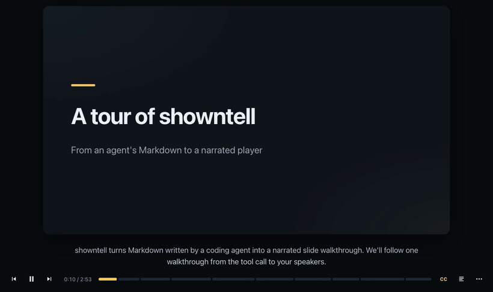
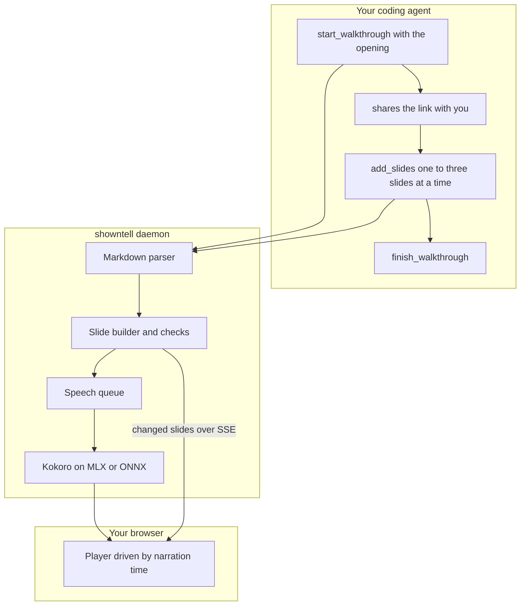

# showntell

Narrated slide walkthroughs for coding agents, voiced on your machine.

Ask your agent to walk you through a pull request, a module or a concept. It writes slides and narration in Markdown; showntell voices them locally with [Kokoro](https://huggingface.co/hexgrad/Kokoro-82M) and hands back a link that starts playing in about a second, while the rest is still being written. A pointer follows the narration through code, diagrams and lists, word by word.



**[Watch the gallery](https://rahimnathwani.github.io/showntell/)**: five walkthroughs written by Claude Opus and voiced on a laptop, unedited: a tour of this repository, a code review of one of its commits, the TLS 1.3 handshake, scaled dot-product attention, and git rebase versus merge on a phone-shaped frame.

- **Local:** speech runs on your Mac or PC. No API keys, no hosted service, no telemetry. Code never leaves your machine except to the model you already use.
- **Fast:** the link is playable about 0.3 s after the agent sends its opening, so you start watching while the agent keeps writing.
- **Grounded:** code slides are read straight from your files and git history, with real line numbers. The agent never retypes code, and the pointer lands on the right line.
- **Checked:** every call returns problems to the agent: a cue pointing at a missing line, code too big for the frame, narration that reads the screen aloud, diagrams that failed to render in the open player.
- **Shareable:** export any walkthrough as a static folder with captions to host anywhere, or as an MP4.

How it compares with a screen recording, a written PR description and a rendered MP4 explainer, including where those win: [docs/comparison.md](docs/comparison.md).

## Install

You need [uv](https://docs.astral.sh/uv/). It installs Python 3.12 or newer for you if needed.

Every agent runs the same command, which starts showntell as a stdio MCP server:

```zsh
uvx --from git+https://github.com/rahimnathwani/showntell showntell mcp
```

Once showntell is on PyPI this shortens to `uvx showntell mcp`. Pick your agent below, then ask it something like *"walk me through how a request gets retried in this codebase"*. The agent replies with a link; open it and press play.

The first run downloads the voice model (about 330 MB on Apple silicon, 92 MB elsewhere) and a 12 MB English language model. The first walkthrough takes a few seconds longer while they load. After that, everything works offline.

### Claude Code

1. Add the server for all your projects:

   ```zsh
   claude mcp add --scope user showntell -- uvx --from git+https://github.com/rahimnathwani/showntell showntell mcp
   ```

2. Start a new `claude` session and run `/mcp`; `showntell` should be listed as connected.
3. Ask for a walkthrough, or use a built-in prompt: `/mcp__showntell__diff HEAD~1..HEAD`, `/mcp__showntell__file src/app.py` or `/mcp__showntell__topic how TLS works`.

**Or install the plugin** instead of step 1. It bundles the same server with a skill that tells Claude when a walkthrough fits and how to pace one:

```zsh
claude plugin marketplace add rahimnathwani/showntell
claude plugin install showntell@showntell
```

Claude Code 2.1.275 or later does both in one step: `claude plugin install showntell --marketplace rahimnathwani/showntell`. Check it with `claude plugin list`. A new release arrives with `claude plugin marketplace update showntell` and then `claude plugin update showntell@showntell`. Use the plugin or `claude mcp add`, not both, or Claude sees two copies of the tools.

### Codex CLI

1. Add the server (this writes `~/.codex/config.toml`):

   ```zsh
   codex mcp add showntell -- uvx --from git+https://github.com/rahimnathwani/showntell showntell mcp
   ```

2. Check it with `codex mcp list`, or run `/mcp` inside a `codex` session.
3. Start `codex` in your project and ask for a walkthrough.

If you prefer to edit the config file yourself, add:

```toml
[mcp_servers.showntell]
command = "uvx"
args = ["--from", "git+https://github.com/rahimnathwani/showntell", "showntell", "mcp"]
```

### Antigravity CLI (agy)

1. Add the server (this writes `~/.gemini/config/mcp_config.json`, which the Antigravity IDE shares). Flags go before the name, and the `--` keeps `--from` from being read as an agy flag:

   ```zsh
   agy mcp add showntell -- uvx --from git+https://github.com/rahimnathwani/showntell showntell mcp
   ```

2. Check it with `agy mcp list`.
3. Start `agy` in your project and ask for a walkthrough. MCP tools ask for approval by default, so allow showntell's tools when prompted. In print mode there is no prompt, so the calls may be refused.

### Gemini CLI

1. Install the extension. It adds the server and a context file with the same guidance as the Claude Code skill:

   ```zsh
   gemini extensions install https://github.com/rahimnathwani/showntell
   ```

2. Check it with `gemini extensions list`, or run `/mcp` inside a `gemini` session.
3. Start `gemini` in your project and ask for a walkthrough. Update later with `gemini extensions update showntell`.

### Pi

Recent Pi (checked with 1.3.0) has MCP built in.

1. Add the server (this writes `~/.pi/agent/mcp.json`; add `-l` to write `.pi/mcp.json` in the current project instead):

   ```zsh
   pi mcp add showntell -- uvx --from git+https://github.com/rahimnathwani/showntell showntell mcp
   ```

2. Check it with `pi mcp list`. It should say `showntell: connected, 5 tools`.
3. Start `pi` in your project and ask for a walkthrough.

Older Pi without `pi mcp` needs the [pi-mcp-adapter](https://github.com/nicobailon/pi-mcp-adapter) extension instead. Run `pi install npm:pi-mcp-adapter`, then put this in `~/.config/mcp/mcp.json`:

```json
{
  "mcpServers": {
    "showntell": {
      "command": "uvx",
      "args": ["--from", "git+https://github.com/rahimnathwani/showntell", "showntell", "mcp"]
    }
  }
}
```

### Other clients

- **VS Code:** add the server to your user profile from a terminal, then pick `showntell` under **MCP: List Servers**:

  ```zsh
  code --add-mcp '{"name":"showntell","command":"uvx","args":["--from","git+https://github.com/rahimnathwani/showntell","showntell","mcp"]}'
  ```

- **GitHub Copilot CLI:** its plugin system reads the same marketplace file as Claude Code: `copilot plugin marketplace add rahimnathwani/showntell`, then `copilot plugin install showntell@showntell`.
- **Cursor, Claude Desktop and others:** add a stdio server with command `uvx` and arguments `--from git+https://github.com/rahimnathwani/showntell showntell mcp`. Most use the same `mcpServers` JSON as the older-Pi example.
- **Over HTTP:** run `uvx --from git+https://github.com/rahimnathwani/showntell showntell serve` and connect the client to `http://localhost:4747/mcp`.

### Good to know

- **One shared daemon:** the first `showntell mcp` starts a background daemon, and later ones reuse it. The voice model stays loaded and every agent shares one port.
- **Checking the setup:** `uvx --from git+https://github.com/rahimnathwani/showntell showntell doctor` checks the models, speech speed, port and daemon.
- **Your walkthroughs:** http://localhost:4747/ lists them; the daemon log is `~/.local/share/showntell/daemon.log`.
- **Faster mornings on a Mac:** `uvx --from git+https://github.com/rahimnathwani/showntell showntell autostart on` starts the daemon at login, so even the first walkthrough of the day comes back as fast as the rest.

## How it works



1. **Opening first.** The agent's first call starts the walkthrough with only the title slide and a sentence or two. It returns as soon as that audio exists, about 0.3 s later, and tells the agent to send you the link.
2. **Voiced in the background.** Later slides are parsed, checked and voiced while you watch. The player waits with a notice if it ever catches up with the writer.
3. **Timed to the word.** Kokoro reports when each word is spoken. Each cue in the narration, a Markdown link like `[the retry limit](#L48)`, moves the pointer as its first word is heard.

## The format

A walkthrough is Markdown. Headings start slides, fenced blocks and lists are what you see, plain paragraphs are what you hear.

````markdown
# How the retry loop works
> Backoff in the HTTP client

A failed request can be sent up to four times. Let's follow one.

## Giving up {#give-up .build}

```python file=src/http/retry.py lines=40-56
```

Each pass through [the loop](#L42 "for attempt in range") sends the request once.
After [the final attempt](#L55) the error goes back to the caller.
````

| Visual | Markdown |
|---|---|
| **Code** | a fenced block, or `file=path lines=10-24` to read it from disk |
| **Diff** | `old` and `new` blocks, a unified `diff` block, or `diff file=path rev=HEAD~1` |
| **Diagram** | a `mermaid` block, any diagram type |
| **Formula** | a `math` block or `$$ … $$`, rendered with KaTeX |
| **Table** | a pipe table |
| **List, steps, cards** | `-` or `1.` items; `.cards` on the heading for cards |
| **Image** | `` from the project |

`.build` on a heading reveals parts as the narration reaches them. The full reference is [docs/format.md](docs/format.md). You can also write a walkthrough by hand and play it with `showntell play talk.md`.

## Commands

| Command | What it does |
|---|---|
| **`showntell mcp`** | stdio MCP server; starts or reuses the daemon |
| **`showntell serve`** | the daemon in the foreground: MCP over HTTP at `/mcp`, the player, and the list of walkthroughs at `/` |
| **`showntell play FILE.md`** | voice a Markdown walkthrough and open it |
| **`showntell export ID\|LINK\|FILE.md OUT [--mp3]`** | a static folder that plays from any web server, with WebVTT captions and a `poster.png` |
| **`showntell export ID\|LINK\|FILE.md OUT.mp4`** | an MP4 video; `--fps`, `--workers`, `--burn-captions` |
| **`showntell list`** | recent walkthroughs |
| **`showntell doctor`** | check models, speech speed, port and daemon |
| **`showntell autostart on\|off\|status`** | macOS: keep the daemon running from login |

### Video export

An output path ending in `.mp4` renders a video. Each frame is captured by seeking the player in headless Chromium, so rendering runs faster than real time and never drops a frame: a 4.4-minute walkthrough renders in 16 to 20 s on an M-series Mac.

```zsh
uvx --from 'showntell[video] @ git+https://github.com/rahimnathwani/showntell' playwright install chromium   # once
uvx --from 'showntell[video] @ git+https://github.com/rahimnathwani/showntell' showntell export <id> talk.mp4
```

| Part | What you get |
|---|---|
| **Picture** | H.264, 30 fps (`--fps`), 1920x1080 for landscape, 1080x1080 square, 1080x1920 portrait; only the slide, no player controls |
| **Sound** | AAC, built from the narration clips at their places on the timeline |
| **Captions** | a mov_text subtitle track; `--burn-captions` also draws them into the picture |
| **Speed** | `--workers` browsers render frame ranges in parallel (default: up to 4); unchanged frames reuse the last screenshot |
| **Checks** | the file's duration must match the timeline within 0.2 s, or the export fails |

Needs [FFmpeg](https://ffmpeg.org/) on PATH and the `video` extra (Playwright). Without Playwright, folder exports still work and skip `poster.png`.

## Settings

Environment variables, also listed in [.env.example](.env.example). Command-line flags override them.

| Variable | Default | Meaning |
|---|---|---|
| **`SHOWNTELL_PORT`** | 4747 | daemon port; the next free one is used if taken |
| **`SHOWNTELL_HOST`** | 127.0.0.1 | interface; anything else requires an access token, which is generated and added to links |
| **`SHOWNTELL_DATA`** | `~/.local/share/showntell` | walkthroughs, audio cache, models, lockfile and log |
| **`SHOWNTELL_VOICE`** | `af_heart` | default voice; any English Kokoro voice, such as `am_michael` or `bf_emma` |
| **`SHOWNTELL_SPEECH`** | `auto` | `mlx` on Apple silicon, `onnx` elsewhere, or `fake` for tests |
| **`SHOWNTELL_PUBLIC_URL`** | | base URL for links when viewing from another device, such as a Tailscale name; links then carry an access token |
| **`SHOWNTELL_ONNX_MODEL`** | `model_quantized` | ONNX variant; `model` (fp32) can be faster on CPUs without AVX2 |
| **`SHOWNTELL_THREADS`** | up to 6 | CPU threads for ONNX speech |

Pronunciations: put `word = spoken form` lines in `~/.local/share/showntell/lexicon.txt`. A lowercase word matches any capitalisation, and the spoken form may be misaki phonemes between slashes (`kubectl = /kjˈubkˌʌtəl/`). showntell already knows several hundred technical terms.

## Privacy and security

- **Network:** showntell listens on localhost only, checks the Host and Origin of every request, and accepts only JSON POSTs.
- **Links:** walkthrough ids are 128-bit random values; writing needs a separate key that only the agent holds.
- **Files:** code and images are read only from the project folder, and git runs only plumbing commands with repository hooks and diff drivers disabled.
- **Downloads:** the only network traffic is the first-run model download.

See [SECURITY.md](SECURITY.md) to report a problem.

## Platforms

| Platform | Speech | Status |
|---|---|---|
| **macOS, Apple silicon** | Kokoro on MLX | primary |
| **Linux, Windows, Intel Mac** | Kokoro on ONNX Runtime (CPU) | supported |

English voices only for now. Kokoro's other languages are on the [roadmap](ROADMAP.md).

## Development

```zsh
uv sync
uv run pytest                    # fast tests, no GPU needed
uv run showntell serve --speech fake   # run without a voice model
```

See [CONTRIBUTING.md](CONTRIBUTING.md), [docs/spec.md](docs/spec.md) and [docs/architecture.md](docs/architecture.md).

## Who uses it

Using showntell on a team or project? Add a line to [ADOPTERS.md](ADOPTERS.md).

## Licence

MIT. Bundled libraries and downloaded models keep their own licences; see [THIRD_PARTY_NOTICES.md](THIRD_PARTY_NOTICES.md).
