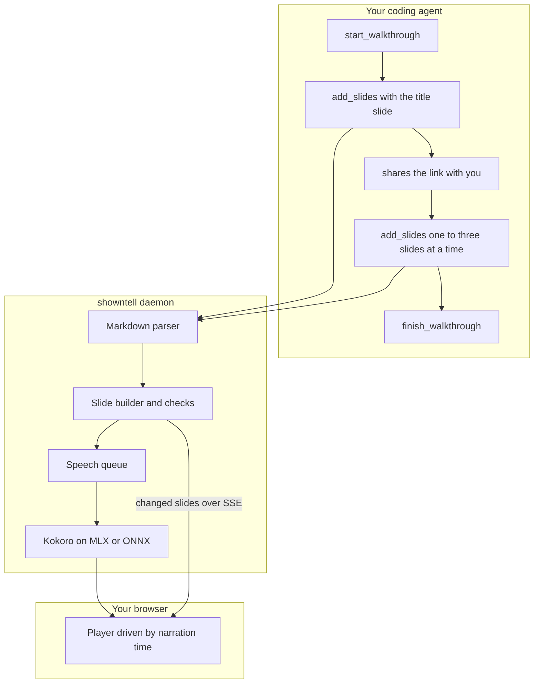

# showntell

Narrated slide walkthroughs for coding agents, voiced on your machine.

Ask your agent to walk you through a pull request, a module or a concept. It writes slides and narration in Markdown; showntell voices them locally with [Kokoro](https://huggingface.co/hexgrad/Kokoro-82M) and hands back a link that starts playing in about a second, while the rest is still being written. A pointer follows the narration through code, diagrams and lists, word by word.

- **Local:** speech runs on your Mac or PC. No API keys, no hosted service, no telemetry. Code never leaves your machine except to the model you already use.
- **Fast:** the link is playable about 0.3 s after the agent sends its opening, so you start watching while the agent keeps writing.
- **Grounded:** code slides are read straight from your files and git history, with real line numbers. The agent never retypes code, and the pointer lands on the right line.
- **Checked:** every call returns problems to the agent: a cue pointing at a missing line, code too big for the frame, narration that reads the screen aloud, diagrams that failed to render in the open player.
- **Shareable:** export any walkthrough as a static folder with captions, and host it anywhere.

## Install

You need [uv](https://docs.astral.sh/uv/) and Python 3.12 or newer, which uv installs for you.

```zsh
claude mcp add showntell -- uvx showntell mcp
```

Then ask Claude Code: *"show me how a request gets retried in this codebase"*.

The first run downloads the voice model (about 330 MB on Apple silicon, 92 MB elsewhere) and a 12 MB English language model, from Hugging Face and GitHub. After that, everything works offline.

| Client | Setup |
|---|---|
| **Claude Code** | `claude mcp add showntell -- uvx showntell mcp` |
| **Cursor, VS Code, Codex CLI, Gemini CLI, Claude Desktop** | a stdio server with command `uvx` and arguments `showntell mcp` |
| **Any client over HTTP** | run `showntell serve`, then connect to `http://localhost:4747/mcp` |

`showntell mcp` starts a shared background daemon the first time, or reuses the running one, so the voice model stays loaded across sessions and every client uses one port. `showntell doctor` checks the setup and measures speech speed.

On a Mac, `showntell autostart on` starts the daemon at login, so the first walkthrough of the day is as fast as the rest.

## How it works



1. **Opening first.** The agent's first call carries only the title slide and a sentence or two. It returns as soon as that audio exists, about 0.3 s, and tells the agent to send you the link.
2. **Voiced in the background.** Later slides are parsed, checked and voiced while you watch. The player waits with a notice if it ever catches up with the writer.
3. **Timed to the word.** Kokoro reports when each word is spoken. Each cue in the narration, a Markdown link like `[the retry limit](#L48)`, moves the pointer as its first word is heard.

## The format

A walkthrough is Markdown. Headings start slides, fenced blocks and lists are what you see, plain paragraphs are what you hear.

````markdown
# How the retry loop works
> Backoff in the HTTP client

A failed request can be sent up to four times. Let's follow one.

## Giving up {#give-up .build}

```python file=src/http/retry.py lines=40-56
```

Each pass through [the loop](#L42 "for attempt in range") sends the request once.
After [the final attempt](#L55) the error goes back to the caller.
````

| Visual | Markdown |
|---|---|
| **Code** | a fenced block, or `file=path lines=10-24` to read it from disk |
| **Diff** | `old` and `new` blocks, a unified `diff` block, or `diff file=path rev=HEAD~1` |
| **Diagram** | a `mermaid` block, any diagram type |
| **Formula** | a `math` block or `$$ … $$`, rendered with KaTeX |
| **Table** | a pipe table |
| **List, steps, cards** | `-` or `1.` items; `.cards` on the heading for cards |
| **Image** | `` from the project |

`.build` on a heading reveals parts as the narration reaches them. The full reference is [docs/format.md](docs/format.md). You can also write a walkthrough by hand and play it with `showntell play talk.md`.

## Commands

| Command | What it does |
|---|---|
| **`showntell mcp`** | stdio MCP server; starts or reuses the daemon |
| **`showntell serve`** | the daemon in the foreground: MCP over HTTP at `/mcp`, the player, and the list of walkthroughs at `/` |
| **`showntell play FILE.md`** | voice a Markdown walkthrough and open it |
| **`showntell export ID\|LINK\|FILE.md OUT [--mp3]`** | a static folder that plays from any web server, with WebVTT captions |
| **`showntell list`** | recent walkthroughs |
| **`showntell doctor`** | check models, speech speed, port and daemon |
| **`showntell autostart on\|off\|status`** | macOS: keep the daemon running from login |

## Settings

Environment variables, also listed in [.env.example](.env.example). Command-line flags override them.

| Variable | Default | Meaning |
|---|---|---|
| **`SHOWNTELL_PORT`** | 4747 | daemon port; the next free one is used if taken |
| **`SHOWNTELL_HOST`** | 127.0.0.1 | interface; anything else requires an access token, which is generated and added to links |
| **`SHOWNTELL_DATA`** | `~/.local/share/showntell` | walkthroughs, audio cache, models, lockfile and log |
| **`SHOWNTELL_VOICE`** | `af_heart` | default voice; any English Kokoro voice, such as `am_michael` or `bf_emma` |
| **`SHOWNTELL_SPEECH`** | `auto` | `mlx` on Apple silicon, `onnx` elsewhere, or `fake` for tests |
| **`SHOWNTELL_PUBLIC_URL`** | | base URL for links when viewing from another device, such as a Tailscale name; links then carry an access token |
| **`SHOWNTELL_ONNX_MODEL`** | `model_quantized` | ONNX variant; `model` (fp32) can be faster on CPUs without AVX2 |
| **`SHOWNTELL_THREADS`** | up to 6 | CPU threads for ONNX speech |

Pronunciations: put `word = spoken form` lines in `~/.local/share/showntell/lexicon.txt`. A lowercase word matches any capitalisation, and the spoken form may be misaki phonemes between slashes (`kubectl = /kjˈubkˌʌtəl/`). showntell already knows several hundred technical terms.

## Privacy and security

- **Network:** showntell listens on localhost only, checks the Host and Origin of every request, and accepts only JSON POSTs.
- **Links:** walkthrough ids are 128-bit random values; writing needs a separate key that only the agent holds.
- **Files:** code and images are read only from the project folder, and git runs only plumbing commands with repository hooks and diff drivers disabled.
- **Downloads:** the only network traffic is the first-run model download.

See [SECURITY.md](SECURITY.md) to report a problem.

## Platforms

| Platform | Speech | Status |
|---|---|---|
| **macOS, Apple silicon** | Kokoro on MLX | primary |
| **Linux, Windows, Intel Mac** | Kokoro on ONNX Runtime (CPU) | supported |

English voices only for now. Kokoro's other languages are on the [roadmap](ROADMAP.md).

## Development

```zsh
uv sync
uv run pytest                    # fast tests, no GPU needed
uv run showntell serve --speech fake   # run without a voice model
```

See [CONTRIBUTING.md](CONTRIBUTING.md), [docs/spec.md](docs/spec.md) and [docs/architecture.md](docs/architecture.md).

## Licence

MIT. Bundled libraries and downloaded models keep their own licences; see [THIRD_PARTY_NOTICES.md](THIRD_PARTY_NOTICES.md).
