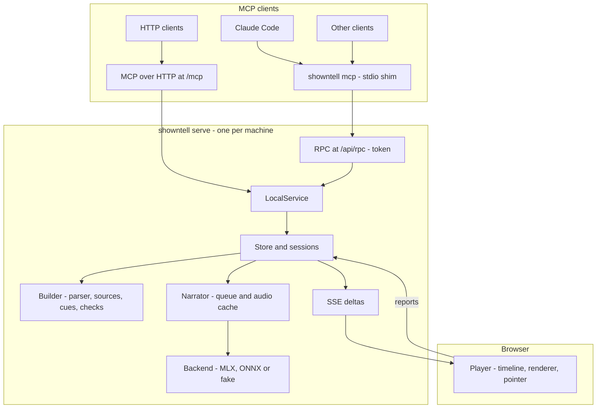

# Architecture

showntell is one Python package and one static web player. A long-lived daemon owns the voice model and the walkthroughs; MCP clients reach it either directly over HTTP or through a small stdio shim.

## Request path

1. **Shim:** `showntell mcp` reads `daemon.json` in the data folder. If no daemon of the same version is healthy, it starts `showntell serve` in the background and waits for `/health`. Its MCP tools forward to the daemon's RPC route with the token from the lockfile.
2. **Service:** `LocalService` implements the five tools. The MCP layer (`server.py`) formats replies, waits for the opening audio with progress notifications, and attaches the guide to the first playable reply.
3. **Builder:** `format.Parser` turns each chunk into blocks; the chunk end closes open blocks except fences. `build.Builder` turns blocks into slides, reads code from disk or git (`sources.py`), resolves and infers cues, and records problems.
4. **Narrator:** every narration paragraph becomes a speech job. `pronounce.speakable` rewrites code and units into speakable text with a character map back to the display text; the job key is a hash of model, voice, speed and spoken text. One worker thread voices jobs in order of their position in their walkthrough.
5. **Events:** each change marks slides as changed; the SSE route coalesces changes for 50 ms and sends only the changed slides plus the slide order.

## Player

`static/js/timeline.js` turns the walkthrough into segments (one per paragraph, with gaps) on a single clock and answers "what should be on screen at time *t*": slide, fired cues, step-reveal level and current word. `main.js` advances the clock from the audio element while a paragraph plays and from wall time during gaps, then applies that state to the DOM through `render.js`. Seeking, live updates and export all go through the same function.

## Data

| Path in the data folder | Contents |
|---|---|
| `daemon.json` | pid, port, version and RPC token of the running daemon (mode 0600) |
| `daemon.log` | daemon log when started in the background |
| `walkthroughs/<id>/state.json` | the walkthrough: slides, narration, cues, timings |
| `walkthroughs/<id>/source.md` | the Markdown as received |
| `walkthroughs/<id>/assets/` | images copied from the project |
| `audio/<key>.wav` and `.json` | voiced narration and its word timings, shared by all walkthroughs |
| `models/` | the spaCy English model |
| `lexicon.txt` | your pronunciations, `word = spoken form` |

Voice models live in the Hugging Face cache (`~/.cache/huggingface`).
