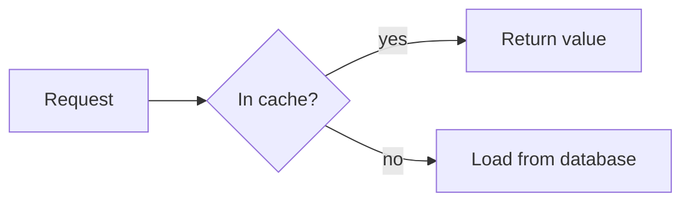

# showntell format, version 1

A walkthrough is a Markdown document. Headings start slides, fenced blocks and lists are what the viewer sees, and plain paragraphs are what the narrator says. Links inside narration move the pointer.

````markdown
# How the cache lookup works
> A read-through cache in sixty lines

Every request checks a small in-memory cache before it touches the database.

## The lookup {#lookup}

```python file=src/cache.py lines=10-24
```

The method starts by [checking the dictionary](#L12 "if key in self._data").
On a miss it [calls the loader](#L18) and stores the result.
````

## Document

| Part | Rule |
|---|---|
| **Front matter** | optional, only at the very start, between `---` lines. Keys: `title`, `frame`, `theme`, `voice`, `speed`. Tools pass these as arguments instead. |
| **Slide** | every heading (`#`, `##` or `###`) starts a slide. The level does not matter. |
| **Title slide** | the first slide renders as a title slide when it has no visual. A `>` quote under it is the subtitle. |
| **Visual** | at most one per slide: a code block, a diff, a diagram, a formula, a table, a list, an image, a chart, a terminal session or a file tree |
| **Shown text** | `>` quote lines are shown on the slide, never spoken |
| **Narration** | every other paragraph is spoken. Each paragraph is voiced separately, with a short pause after it. |
| **Questions** | a slide whose heading has the `.questions` class is not shown; its list items become the questions offered at the end. Questions passed to `finish_walkthrough` replace them. |

Text before the first heading belongs to an automatic title slide that uses the walkthrough's title.

## Heading attributes

A heading may end with attributes in braces: `## The lookup {#lookup .build}`.

| Attribute | Meaning |
|---|---|
| **`#id`** | the slide's id, used to revise it later. Letters, digits, `-` and `_`. Generated from the title when missing. |
| **`.cards`** | show a list as a grid of cards |
| **`.steps`** | show a list as numbered steps (same as writing `1.` items) |
| **`.build`** | step reveal: parts appear as narration points at them |
| **`.questions`** | the end-of-walkthrough questions, not a slide |
| **`alt="..."`** | text alternative for a diagram or image |
| **`voice=`, `speed=`** | reserved: per-slide voice and speed |

## Visuals

### Code

````markdown
```python
def get(self, key):
    ...
```
````

The info string after the language may hold options:

| Option | Meaning |
|---|---|
| **`file=path`** | read the code from this file in the project. Leave the block body empty. |
| **`lines=10-24`** | with `file=`: the line range to show |
| **`start=10`** | number the first line 10 when the code is written inline |
| **`title="..."`** | caption above the code; defaults to the file name |

Line numbers in the gutter are the file's own line numbers, and cues use the same numbers.

**Long code:** `scroll` in the info string (```` ```python file=src/app.py lines=1-200 scroll ````) keeps the code at reading size, however long (up to 400 lines), shows as much as fits, scrolls so the latest cued range sits in the middle, and dims the other lines.

**Code that evolves:** consecutive code blocks marked `step` become versions of one piece of code on one slide. `#step-2` moves to the second version: lines that stay glide to their new place and new lines fade in. Line cues after a step cue count lines in that version.

````markdown
```python step
def total(xs):
    t = 0
    for x in xs:
        t += x
    return t
```
```python step
def total(xs):
    return sum(xs)
```

The loop [adds each value](#L4). It then [collapses into one call](#step-2), where [sum](#L2 "sum") does the work.
````

### Diff

Three ways to show a change side by side:

````markdown
```python old
total = 0
for x in xs: total += x
```
```python new
total = sum(xs)
```
````

````markdown
```diff
-total = 0
-for x in xs: total += x
+total = sum(xs)
```
````

````markdown
```diff file=src/stats.py rev=HEAD~1
```
````

With `file=` and `rev=`, the server reads both versions from git: `rev=A` compares commit `A` with the working tree, and `rev=A..B` compares two commits. It shows the changed region with a few lines of context; `lines=` narrows the new side to that range instead. A pasted `diff` block is numbered from its first `@@` header, so send one hunk per slide.

### Diagram

````markdown

````

Any Mermaid diagram type works. Give each node a short id so narration can point at it.

### Formula

````markdown
```math
\mathrm{softmax}(z)_i = \frac{e^{z_i}}{\sum_j e^{z_j}}
```
````

A `$$ ... $$` block works too. The content is LaTeX rendered with KaTeX.

### Table

A GitHub-style pipe table. Cells may hold inline code and emphasis. Rows are `#row-1`, `#row-2` and so on for cues, unless the last cell of a row ends with `{#id}`.

### List

```markdown
- **Memory**: fast, gone on restart {#memory}
- **Disk**: survives restarts {#disk}
```

Bullets give a bulleted list and `1.` items give numbered steps; add `.cards` to the heading for cards, or `.stack` for layers drawn as a stack (top item on top). Items starting with `[x]` or `[ ]` make a checklist: a ticked item's tick draws in when narration points at it, or at once if the slide has no item cues; `[ ]` stays empty. An item may start with a bold title, followed by `:` or a dash and a description. A trailing `{#id}` names the item for cues; without one, the id is the title in lowercase with hyphens (`**Hot path**` becomes `#hot-path`). Nested lists are flattened.

### Image

```markdown

```

A path is read from the project folder and copied into the walkthrough. An `https://` URL is shown as is.

`{frame=browser url="shop.example.com"}` after the image draws it in browser chrome with that address; `frame=window` and `frame=phone` work too. A cue can point at part of the picture with `#@left,top,width,height`, in percent of the picture: `[the search box](#@5,17,54,8)`.

### Chart

````markdown
```chart bar title="p95 latency" unit="ms"
series: before, after
read: 420, 180
write: 610, 390
```
````

| Type | Body | Cue targets |
|---|---|---|
| **`bar`** | one `label: value` line per bar; for grouped bars a `series: a, b` line first, then `label: 1, 2` | `#label`: the bar's label, lowercased with hyphens |
| **`hbar`** | as `bar`, one series, drawn horizontally for long labels | `#label` |
| **`line`** | an `x: …` line first, then one `name: v1, v2, …` line per series with as many values as x values | `#name`: the series |

Options: `title=`, `unit=` (shown after values), `x=` and `y=` (axis labels). Values may carry a unit suffix such as `ms` or `%`. At most 12 bars or series read well. The player draws the chart in the theme's colours.

A `note` line adds a callout: `note 400: tail grows here` at that x value (every series), `note p99/400: …` on one series, or `note write: …` above a bar. Cue notes as `#note-1`, `#note-2` in the order written.

### Numbers

````markdown
```stat
p95 latency: 420 ms -> 180 ms
error rate: 2.1% -> 0.3%
```
````

One to four big numbers, each `label: value` or `label: before -> after`; values may carry a unit, or `unit=` sets one for all. Each number counts from its first value to its last when narration points at it (`#p95-latency`), or at the start of the slide if no cue names a number.

### Exchange

````markdown
```chat
user: How do I undo my last commit?
assistant: Run `git reset --soft HEAD~1`.
  Your changes stay staged.
```
````

One message per `name: text` line; indented lines continue the message above. A user, client or browser sits on the right; otherwise the first speaker is on the left and the second on the right. Cue messages as `#m1`, `#m2` in order. At most 8 messages read well. `exchange` works as the name too.

### Chapter card

A heading with `.chapter` is a card that opens a part of the walkthrough, numbered Part 1, Part 2 and so on, with an optional `>` line under it. It needs no narration.

### Terminal session

````markdown
```terminal
$ uv run pytest -q
720 passed in 51.2s
```
````

Lines starting with a prompt (`$`, `%` or `>`) are commands; the rest is output. `console` and `shell-session` work as names too. Cues point at lines with `#L3`, counting from 1 with output lines included; `start=` changes the first number. Size limits are those of code.

### File tree

````markdown
```tree
src/
  app.py   # entry point
  cache/
    lru.py
tests/
```
````

One entry per line, nested by indentation (any consistent step) or pasted from the `tree` command. A trailing `/`, or deeper lines below, mark a folder; `# note` after an entry shows a short note. Cues point at an entry by its path (`#src/cache/lru.py`) or by a file or folder name that is unique in the tree (`#lru.py`).

## Narration

Narration is plain prose written to be heard. Markdown inside it is used like this:

| Markup | Effect |
|---|---|
| **`` `code` ``** | read as code: `camelCase` and `snake_case` are split into words, symbols are spoken |
| **`**bold**`, `_italic_`** | shown in captions; no effect on the voice |
| **`[label](#target)`** | a cue: the pointer moves to the target as the label is spoken |
| **`[text]{say="spoken"}`** | shows `text` in captions and speaks `spoken` instead; `spoken` may be phonemes between slashes, as in `say="/kˈOkəɹO/"` |
| **`[^1]`** | reserved: citation, listed in the transcript and never read aloud |
| **`{pause=1.5}`** | a paragraph holding only this adds silence, in seconds (at most 5) |

## Cues

A cue is a Markdown link inside narration. The label is spoken normally. The pointer moves when the first word of the label is spoken, so put the link a little before the moment you want the viewer to look.

| Target | Points at |
|---|---|
| **`#L12`** | line 12 of the slide's code |
| **`#L12-18`** | lines 12 to 18 |
| **`#-L5`** | line 5 of the old side of a diff |
| **`#+L7`**, **`#L7`** | line 7 of the new side of a diff |
| **`#id`** | a list item, card, diagram node, table row, chart bar or series, or file-tree entry with that id |
| **`#a->b->c`** | a flowchart path: a dot travels along those edges, one hop at a time |
| **`#@10,20,30,15`** | part of an image: left, top, width and height in percent |
| **`#step-2`** | the second version of code written as `step` blocks |
| **`#`** | the slide's whole visual |

A title in quotes narrows the target to that exact text: `[the guard](#L12 "if key in self._data")` highlights only that text on line 12. With `#` alone, the quoted text is searched for anywhere in the visual: `[the decision](# "In cache?")` points at the diagram node with that label.

Cues only point within the current slide.

A style after the link changes how the pointer looks: `[the guard](#L12){.circle}`.

| Style | Draws |
|---|---|
| **`.box`** | the default frame |
| **`.circle`** | a hand-drawn ring |
| **`.underline`** | a hand-drawn line underneath |
| **`.arrow`** | an arrow pointing at the target |
| **`.highlight`** | a marker stroke behind the target |
| **`.zoom`** | the camera zooms onto the target until the next cue; combine with another style, as in `{.zoom .circle}` |

When narration has no cues at all, showntell infers some by matching its words against code identifiers, node labels and list titles.

## Step reveal

With `.build` on the heading, the slide starts mostly empty and fills in as the narration points:

| Visual | Behaviour |
|---|---|
| **List, cards, table** | items or rows appear up to the latest one pointed at by id |
| **Code** | lines appear up to the end of the latest line range pointed at |
| **Flowchart** | nodes appear in source order up to the latest node pointed at (an edge path counts its nodes); an edge draws itself in once both its ends are visible |
| **Chart, file tree, numbers, exchange** | bars, series, entries, numbers or messages appear in source order up to the latest one pointed at |
| **Terminal** | lines appear up to the end of the latest line range pointed at, as for code |

Everything is visible once the slide's narration ends.

## Frames and limits

| Frame | Size | Code lines | Code width | Diff lines per side | Diff width per side |
|---|---|---|---|---|---|
| **landscape** | 1280 × 720 | 18 | 90 | 18 | 46 |
| **square** | 960 × 960 | 26 | 68 | 22 | 32 |
| **portrait** | 720 × 1280 | 34 | 48 | 18 | 52 |

These are the sizes that still render at a comfortable reading size, measured with `scripts/measure_limits.py`. Larger code still renders, but smaller. Diffs show the two sides next to each other in landscape and square, and stacked in portrait.

## Themes

| Theme | Look |
|---|---|
| **`dark`** | the default |
| **`light`** | white slides |
| **`paper`** | warm off-white slides |
| **`contrast`** | black slides, white text, yellow pointer |

The walkthrough's theme comes from `start_walkthrough`'s `theme`, else front matter `theme:`, else the project's `showntell.theme.json`, else `dark`. Viewers can switch with `?theme=` or the player menu. A project file can also replace single colours:

```json
{ "theme": "light", "tokens": { "accent": "#0969da", "node-line": "#8250df" } }
```

Token names are those defined in `static/themes.css`. Values must be colours (`#rrggbb`, `rgb()`, `rgba()`); anything else is reported and ignored. Every built-in theme meets WCAG contrast for its text.

## Reserved for later versions

Pronunciation of other languages, citations, per-slide voice and speed, quizzes and scene animations. Parsers must ignore attributes and classes they do not know.
