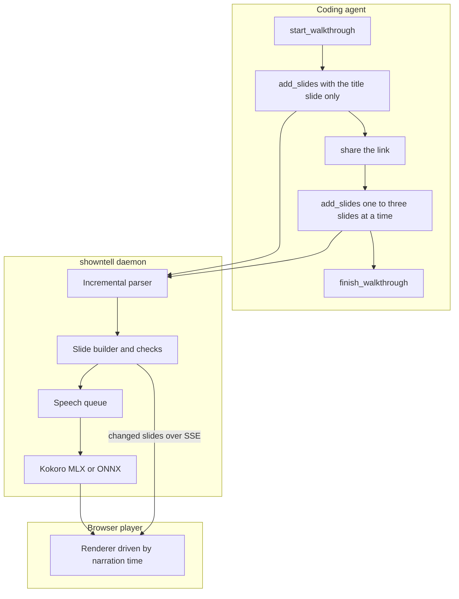

# showntell functional spec

This is the reference for how showntell behaves. The slide format is in [format.md](format.md).

## Flow

1. **Start:** `start_walkthrough` creates the walkthrough and returns a handle and its link. The reply is short, and the essentials of the format are already in the tool description, so the agent writes the opening at once.
2. **Opening:** the agent sends only the title slide and one or two sentences. The call returns when that narration is voiced: about 0.3 s with the model loaded. The reply says the link is playable, tells the agent to share it now, and carries the full authoring guide.
3. **Body:** the agent adds one to three slides per call. Each call returns at once with problems found in what it sent and anything the open player reported.
4. **Finish:** `finish_walkthrough` closes it, records the end questions, and returns a summary with remaining problems.

## Tools

| Tool | Arguments | Returns |
|---|---|---|
| **start_walkthrough** | `title`, `frame` (landscape, square, portrait), `voice`, `speed`, `project_dir` | `handle`, `url`, short next step |
| **add_slides** | `handle`, `markdown` | `status`, `url` once playable, `issues`, progress, the guide on the first playable reply |
| **revise_slide** | `handle`, `slide` (id), `markdown` (one slide) | `issues`; only changed narration is voiced again |
| **finish_walkthrough** | `handle`, `questions` (optional list) | summary, `issues` |
| **list_walkthroughs** | none | recent walkthroughs with handles, titles and links |

All tools return structured content and a readable text version. Tools carry titles and annotations: `list_walkthroughs` is read-only, none destroy data, all work in a closed world.

**Prompts:** `diff`, `file` and `topic` return a ready-made request for a walkthrough of a change, a file or a concept. Claude Code shows them as slash commands.

**Resources:** `showntell://walkthroughs` lists recent walkthroughs, and `showntell://walkthroughs/{id}` holds one walkthrough's Markdown source, so a later session can read and revise it.

## Project root

Code blocks with `file=` and images with a path read from the project root, which is the first of:

1. **Argument:** `project_dir` passed to `start_walkthrough`.
2. **MCP roots:** the first root the client reports.
3. **Shim directory:** the stdio shim's working directory. Claude Code starts stdio servers in the project folder.

Paths must stay inside the root after resolving symbolic links. Git runs only plumbing commands (`rev-parse`, `cat-file`) with fsmonitor disabled, and diffs are computed in Python, so a repository's diff drivers, filters and hooks never run.

## Document model

| Unit | Holds |
|---|---|
| **Walkthrough** | id (128-bit), write key, title, frame, voice, speed, project root, status, questions, Markdown source, format version, state version |
| **Slide** | stable id, revision, kind, title, classes, visual data, shown text, narration |
| **Narration** | display text, spoken text, cues, audio file, duration, word timings, status |
| **Cue** | position in the display text, target, optional exact text, inferred flag, resolved time |

Audio files are named by a hash of model, voice, speed and spoken text and kept in one cache, so revising or replaying never voices the same text twice.

State is saved as JSON next to the source after each change (debounced) and reloaded on demand. Narration still waiting for audio after a restart is queued again.

## Speech

- **Backends:** one interface, two implementations. MLX (mlx-audio) on Apple silicon, ONNX Runtime elsewhere. Both use Kokoro-82M with misaki for English phonemes and return per-token timings.
- **Queue:** one worker. Jobs are ordered by their position in their walkthrough, so the opening narration of a new walkthrough jumps ahead of a backlog.
- **Pronunciation:** narration is rewritten into speakable text before synthesis: identifiers are split, symbols, units, versions and paths are read aloud, and a user word list applies. A character map ties spoken words back to the display text, so captions and cues use what the agent wrote.
- **Timings:** each spoken token is located in the spoken text, then mapped to display offsets. A cue fires at the start time of the first word at or after its position.

## Player

- **Data:** the full walkthrough on connect, then only changed slides over server-sent events. A static export reads the same JSON from a file.
- **Time-driven:** every narration has a start time on one timeline, and the visible state (slide, revealed parts, pointer, highlighted entry, caption word) is computed from the current time. Playback, seeking and export all use that one function.
- **Waiting:** when playback reaches narration without audio yet, it pauses and shows that the next slide is being written.
- **Reports:** render errors are posted back to the server with the per-walkthrough report key and reach the agent, marked as player reports, on its next call.

## Checks returned to the agent

| Check | Example message |
|---|---|
| **Unknown cue target** | `#L40` is past the last line of the code on slide `lookup` |
| **Text not found** | the quoted text is not on the target line; moved to line 14 where it occurs |
| **No narration** | slide `storage` has nothing to say |
| **Too big** | the code is 31 lines; this frame shows 18 comfortably |
| **Pacing** | slide `lookup` shows 22 lines with about 4 s of narration |
| **Reading the screen** | narration repeats the shown text word for word |
| **Sameness** | three slides open with the same words |
| **Render error** | reported by the player: Mermaid parse error on line 3 |
| **File** | `src/cache.py` not found under the project root |

## Install and daemon

- **Commands:** `showntell mcp` (stdio server for MCP clients), `showntell serve` (the daemon), `showntell play FILE.md`, `showntell export`, `showntell doctor`, `showntell list`.
- **Shared daemon:** `showntell mcp` reads the lockfile in the data folder (pid, port, version, token). If the daemon is not running, it starts one in the background and waits for `/health`. If the versions differ and the daemon is idle, it is replaced.
- **Port:** 4747 by default; the next free port if that one is taken.
- **Direct HTTP:** MCP clients can also connect straight to `http://localhost:4747/mcp`.
- **First run:** downloads the Kokoro weights and the spaCy English model, with progress on stderr. `showntell doctor` checks models, port, voices and speech speed.

## Security

- **Loopback by default:** every route checks the Host header and, for POSTs, the Origin header. POSTs must be JSON.
- **Keys:** walkthrough ids are 128-bit. Writing needs the write key in the handle. Player reports need the report key embedded in the player page.
- **Untrusted reports:** player reports are passed to the agent marked as untrusted.
- **Beyond localhost:** binding to another interface requires an access token, added to every link.
