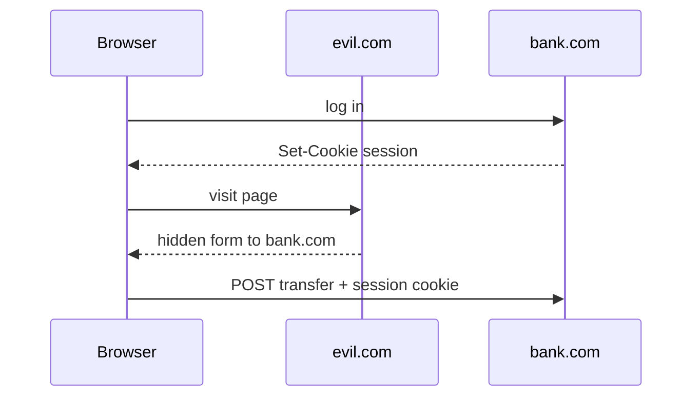
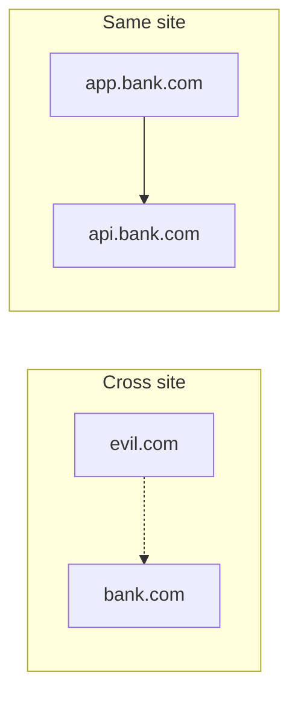
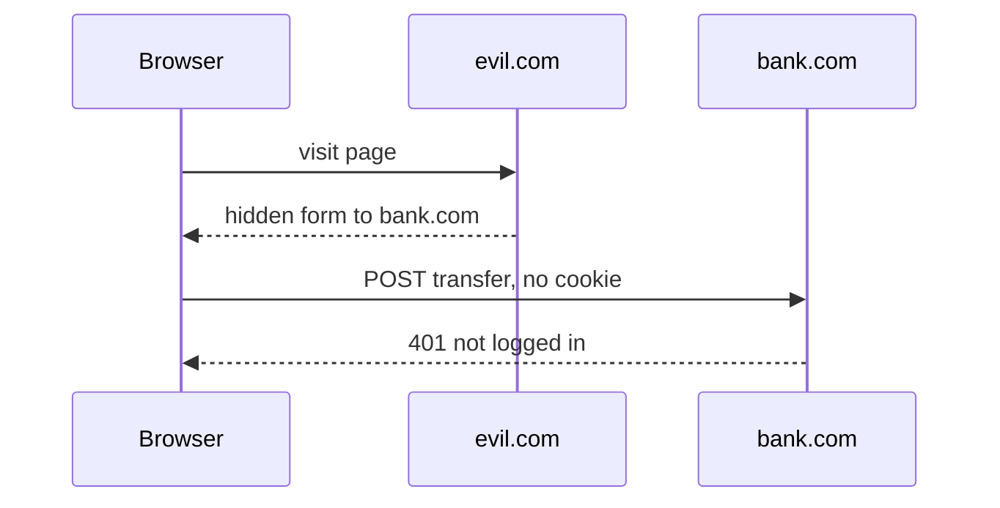

# CSRF and SameSite cookies
> Why a forged request carries your login, and how browsers stop it

A malicious page can make your browser send a request to your bank. We'll see why that works, and how the SameSite attribute closes the hole.
## Cookies ride along {#ambient}
> The browser attaches them to every request to that site, whoever started it



You log in to the bank. It [sets a session cookie](#B-->>U), and from then on the browser sends that cookie with every request to the bank.

Then you [open another site](#U->>E). That page contains a hidden form aimed at the bank.

The browser [submits it](#U->>B), and attaches your cookie, because the request is going to the bank. The bank sees a valid session and moves the money.

## What the attacker needs {#recipe .cards}

- :cookie: **Session cookie**: sent automatically {#a}
- :target: **Known request**: no secret to guess {#b}
- :link: **A visit**: to the attacker's page {#c}

The first condition is [a cookie based session](#a). The victim's browser supplies the credentials, not the attacker.

Second, [a request](#b) whose every parameter the attacker can predict. The bank can't tell it from a real one.

Third, [one visit](#c). The attacker never reads the response. A side effect is enough.

## The forged form {#form}
> One auto-submitting form is the whole attack

```html
<!-- on evil.com -->
<form action="https://bank.com/transfer" method="POST">
  <input name="to" value="attacker">
  <input name="amount" value="5000">
</form>
<script>document.forms[0].submit()</script>
```

[The form's action](#L2 "action=") points at the bank, not at the attacker's own server.

[The fields](#L3-4) are exactly what the bank expects.

And [the script](#L6) submits it the moment the page loads. You see nothing.

## Same site, not same origin {#site .side}



> SameSite compares registrable domains
> Subdomains and ports don't matter
> Scheme is part of it too

SameSite is about sites, not origins. A [request from evil.com](#e) to the bank is cross-site.

But [two subdomains](#a) of the same registrable domain count as the same site, and so do different ports.

## Three SameSite values {#values}
> Strict blocks most, Lax blocks forged POSTs, None blocks nothing

| Value | Cross-site POST | Cross-site link click | Notes |
|---|---|---|---|
| Strict | no cookie | no cookie | login lost on arrival |
| Lax | no cookie | cookie sent | browser default now |
| None | cookie sent | cookie sent | needs Secure |

With [Strict](#row-1) the cookie never travels on a cross-site request, even when you click a link. You arrive logged out.

[Lax](#row-2) sends it on top-level navigations that only read, like following a link, but withholds it on forged POSTs, form posts and subresource loads.

[None](#row-3) restores the old behaviour, and browsers require the Secure flag with it.
## Lax blocks the forgery {#blocked}
> The cross-site POST arrives without a session cookie



The attack starts the same way. You [visit the page](#U->>E) and the form fires.

But the cookie is marked `SameSite=Lax`, and this is a cross-site POST. So [the request goes out bare](#U->>B).

The bank sees no session and [refuses](#B-->>U). The forgery fails.

## Set it explicitly {#header}
> Defaults vary by browser, so state it

```http
Set-Cookie: session=abc123; SameSite=Lax; Secure; HttpOnly; Path=/
```

[SameSite=Lax](# "SameSite=Lax") is the part that stops forged POSTs.

[Secure and HttpOnly](# "Secure; HttpOnly") are separate: HTTPS only, and hidden from scripts.

## What SameSite doesn't cover {#gaps}
> Defence in depth still applies

- :zap: **GET with side effects**: Lax sends cookies on link clicks, so never change state on GET {#get}
- :globe: **Sibling subdomains**: a hijacked subdomain is same-site and bypasses it {#sub}
- :key: **CSRF tokens**: a per-session secret in each form closes both gaps {#token}

Lax still sends cookies on [top-level GET navigations](#get), so a state-changing GET stays exploitable.

A [compromised subdomain](#sub) is same-site, so the browser sends the cookie.

That's why [CSRF tokens](#token) remain worth adding: the attacker cannot read the secret from another site.

## Which request is blocked? {#quiz .quiz}

- [ ] A link click from evil.com to bank.com under Lax
- [x] A hidden form POST from evil.com to bank.com under Lax
- [ ] A request from app.bank.com to api.bank.com under Strict

Which of these loses its cookie?

{pause=3}

It's [B](#b). The link click is a safe top-level navigation, so Lax allows it. And the subdomain request is same-site, so even Strict sends the cookie.
