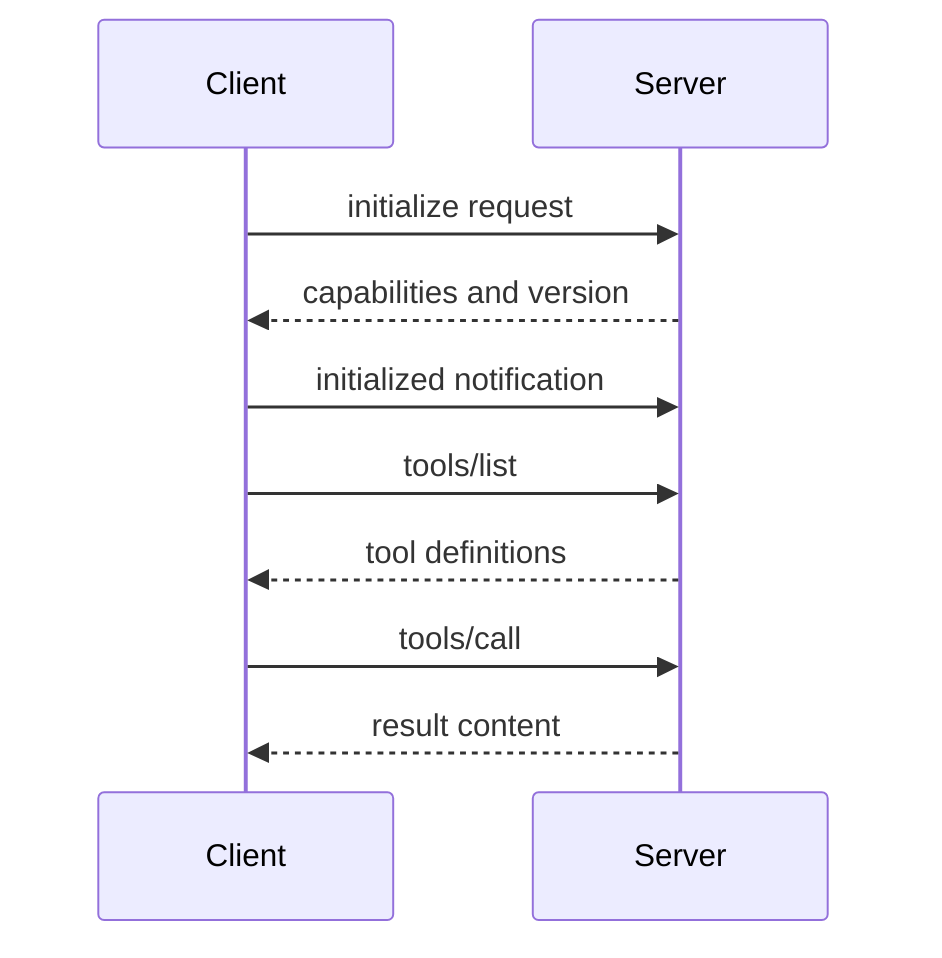

# MCP: one tool call on the wire
> initialize, tools/list, tools/call

An MCP client and server talk in JSON-RPC messages. We'll follow three exchanges, in order, until a tool actually runs.
## The whole conversation {#overview}



The client is the app hosting the model. The server owns the tools. Messages travel as JSON-RPC over standard input and output, or over HTTP.

First comes [the handshake](#C->>S), where both sides agree on a protocol version and what they support. Then the client [asks what tools exist](# "tools/list"). Last, it [calls one](# "tools/call") and gets a result back.
## Step one: initialize {#initialize}

```chat
client: {"jsonrpc":"2.0","id":1,"method":"initialize","params":{"protocolVersion":"2025-06-18","capabilities":{},"clientInfo":{"name":"my-app","version":"1.0"}}}
server: {"jsonrpc":"2.0","id":1,"result":{"protocolVersion":"2025-06-18","capabilities":{"tools":{"listChanged":true}},"serverInfo":{"name":"weather","version":"0.3"}}}
client: {"jsonrpc":"2.0","method":"notifications/initialized"}
```

The client speaks first. [Its request](#m1) carries a protocol version and its own capabilities.

[The server replies](#m2) with the version it will use and what it offers. Here it says it has tools, and that it will tell the client when that list changes.

Then [the client sends a notification](#m3). It has no id, so no reply is expected. It just means: ready.
## Step two: tools/list {#tools-list}

```chat
client: {"jsonrpc":"2.0","id":2,"method":"tools/list"}
server: {"jsonrpc":"2.0","id":2,"result":{"tools":[{"name":"get_weather","description":"Current weather for a city","inputSchema":{"type":"object","properties":{"city":{"type":"string"}},"required":["city"]}}]}}
```

[The list request](#m1) has no parameters. Its id is two, and the reply will echo it, so the client can match answers to questions.

[The reply](#m2) describes each tool with a name, a description and a JSON Schema for its input. The client passes these to the model. The model never sees the wire format, only these definitions.
## Step three: tools/call {#tools-call}

```chat
client: {"jsonrpc":"2.0","id":3,"method":"tools/call","params":{"name":"get_weather","arguments":{"city":"Cairo"}}}
server: {"jsonrpc":"2.0","id":3,"result":{"content":[{"type":"text","text":"34C, clear"}],"isError":false}}
```

The model decides to use a tool. The client turns that into [a call](#m1) with the tool name and arguments matching the schema.

The server runs the code and returns [content blocks](#m2). Text is common, but images and resources also work.

A failing tool still gets a normal result, with `isError` set to true, so the model can read the failure and react. Protocol-level problems, like an unknown tool name, come back as a JSON-RPC error instead.
## What to remember {#summary .cards}

- **Handshake**: initialize, then an initialized notification, fixes version and capabilities {#handshake}
- **Discovery**: tools/list returns names, descriptions and input schemas {#discovery}
- **Execution**: tools/call sends a name and arguments, gets content blocks back {#execution}
- **Matching**: ids pair responses with requests; notifications carry no id {#matching}

Four things carry the whole exchange.

[The handshake](#handshake) happens once per connection. [Discovery](#discovery) tells the model what it can do. [Execution](#execution) is the only step with side effects.

And [the ids](#matching) let many requests be in flight at once without confusion.

## Questions {.questions}

- What happens when the server's tool list changes mid-session?
- How does the stdio transport differ from streamable HTTP?
- Can a server ask the client for something, such as a model completion?

<!-- revised overview -->
## The whole conversation {#overview}


The client is the app hosting the model. The server owns the tools. Messages travel as JSON-RPC over standard input and output, or over HTTP.

First comes [the handshake](# "initialize request"), where both sides agree on a protocol version and what they support. Then the client [asks what tools exist](# "tools/list"). Last, it [calls one](# "tools/call") and gets a result back.

<!-- revised tools-call -->
## Step three: tools/call {#tools-call}

```chat
client: {"jsonrpc":"2.0","id":3,"method":"tools/call","params":{"name":"get_weather","arguments":{"city":"Cairo"}}}
server: {"jsonrpc":"2.0","id":3,"result":{"content":[{"type":"text","text":"34C, clear"}],"isError":false}}
```

The model decides to use a tool. The client turns that into [a call](#m1) with the tool name and arguments matching the schema.

The server runs the code and returns [content blocks](#m2). Text is common, but images and resources also work.

A failing tool still gets a normal result, with [the error flag](#m2 "isError") set to true, so the model can read the failure and react. Protocol-level problems, like an unknown tool name, come back as a JSON-RPC error instead.
