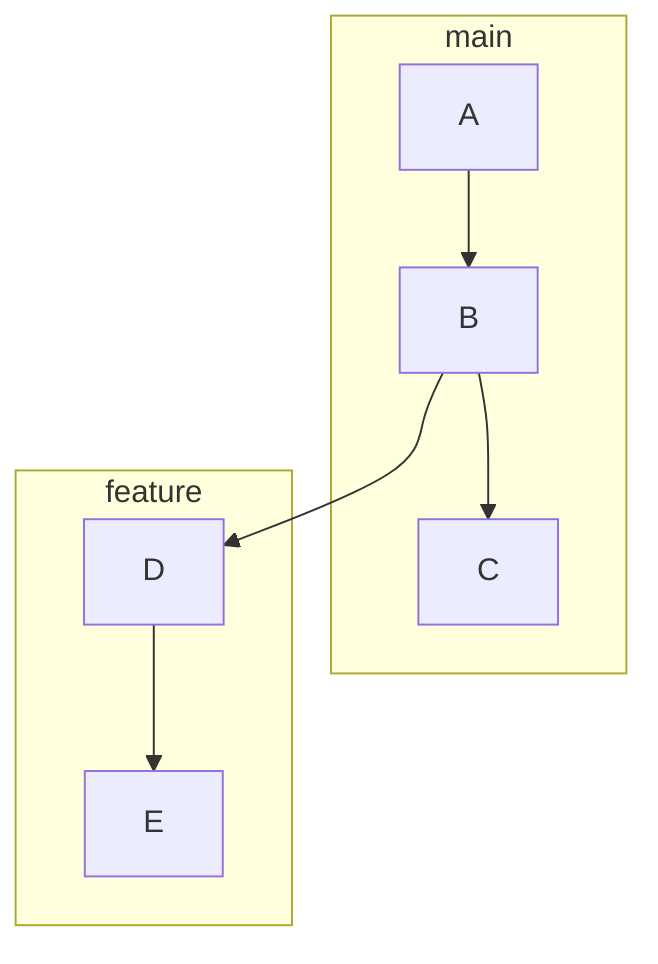
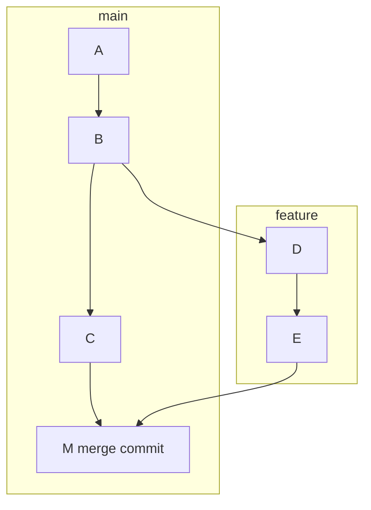
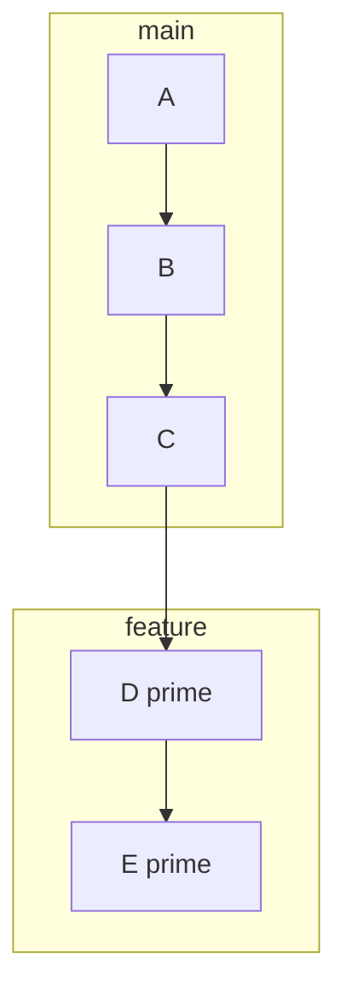

# Git rebase versus merge
> Two ways to combine branches

Merge and rebase both bring a feature branch up to date with main. They differ in the history they leave behind.
## The starting point

[Feature](#D) branched off at commit [B](#B). Since then, main gained commit [C](#C), and feature gained [D and E](#E). The branches have diverged.
## Merge: tie the ends together

`git merge feature` creates a new [merge commit, M](#M), with two parents: [C](#C) and [E](#E).

Nothing is rewritten. [D and E](#D) keep their original hashes, so the graph records exactly what happened, in parallel.

## Rebase: replay on top

`git rebase main`, run on feature, lifts D and E off and replays them on top of [C](#C).

The results, [D prime](#D2) and [E prime](#E2), are new commits with new hashes. The history becomes one straight line, as if you started the work today.
## Side by side

| | Merge | Rebase |
|---|---|---|
| History | true, branched | linear, rewritten |
| Hashes | kept | replaced |
| Conflicts | once | per commit |
| Shared branches | safe | risky |

Merge keeps the [true history](#row-1) and resolves [conflicts once](#row-3). Rebase gives a clean line, but you may resolve conflicts commit by commit.

## The golden rule

- **Rebase**: your own local, unpushed branch {#local}
- **Merge**: anything others have pulled {#shared}

Rebase freely on [work only you have](#local). Never rebase [commits others already pulled](#shared): their copies still point at the old hashes, and the histories split.
