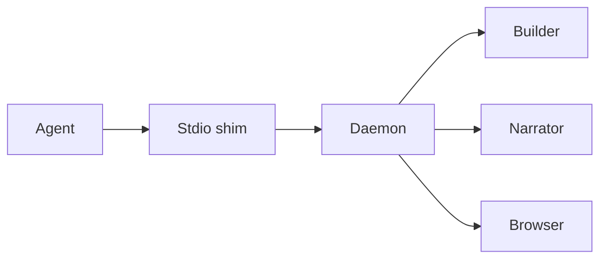
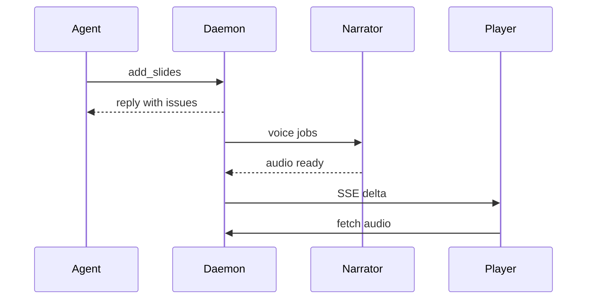
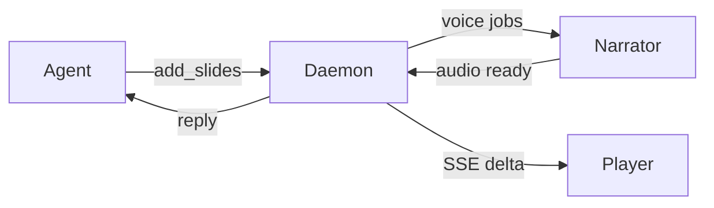

# One add_slides call, end to end
> From the coding agent to the browser player

The agent sends Markdown and a few seconds later the browser shows narrated slides. We'll follow that one call through the stdio shim, the daemon, the builder and the narrator.
## The route {#route .build}



The agent speaks MCP over stdio to [a small shim](#sh).

The shim forwards the call to [the daemon](#dm), which is one long-lived process per machine.

Inside it, [the builder](#bd) turns Markdown into slides, and [the narrator](#nr) turns their text into speech.

Finally the daemon pushes the result to [the browser](#br).
## Shim to daemon {#shim}

```python file=src/showntell/service.py lines=153-168
```

The agent's tool call lands in the shim, which looks for `daemon.json` in the data folder. If no daemon of the same version is healthy, it starts `showntell serve` and waits for `/health`.

Then [the shim's service](#L153 "class RemoteService") forwards the call as [an HTTP post](#L164 "self.client.post") to `/api/rpc/add`, with the arguments as JSON.

[The bearer token](#L158 "headers={\"Authorization\": f\"Bearer {token}\"}") comes from the lockfile. The daemon checks it, and only then runs the method.

## Inside the daemon {#daemon}

```python file=src/showntell/server.py lines=472-492
```

[The route](#L472 "/api/rpc/{method}") compares the token in constant time, then [checks the method name](#L481 "if method not in RPC_METHODS") against an allow list.

It then [calls the same method](#L486 "getattr(service, method)(**kw)") on `LocalService` that the HTTP MCP route would call. A `ValueError` becomes a 400 with the message, so the agent sees a plain error.

<!-- revised daemon -->
## Inside the daemon {#daemon}

```python file=src/showntell/server.py lines=472-489
```

[The route](#L472 "/api/rpc/{method}") compares the token in constant time, then [checks the method name](#L481 "if method not in RPC_METHODS") against an allow list.

It then [calls the same method](#L485 "getattr(service, method)(**kw)") on `LocalService` that the HTTP MCP route would call. A `ValueError` becomes a 400 with the message, so the agent sees a plain error.
## Builder and narrator {#build-narrate}

```python file=src/showntell/store.py lines=58-74
```

`Session.add` first appends the Markdown to the stored source. Then [the builder](#L66 "b.add(markdown)") parses it into slides, reads code from disk, resolves cues and records problems.

Every narration paragraph becomes a new say. [Each one](#L70 "self._voice(slide, say)") asks the narrator for audio. The job key is a hash of model, voice, speed and spoken text, so a cache hit returns at once.

On a miss, the job joins a queue ordered by position in the walkthrough, and one worker thread voices them in turn. Finally [the change is announced](#L72 "self._changed(b.changed)").

## Reply and push {#push}



The reply goes back [at once](#A->>D), listing problems. It does not wait for the audio, so the agent can keep writing.

As [the narrator finishes](#N-->>D) each paragraph, the daemon marks that slide changed. The event stream coalesces changes for fifty milliseconds and sends [only the changed slides](#D->>P) plus the slide order.

The player then [fetches the audio](#P->>D) and plays it against its timeline, so you see the slide appear while the agent is still writing the next one.

<!-- revised build-narrate -->
## Builder and narrator {#build-narrate}

```python
b.add(markdown)
# ... slide limit check omitted
for slide, say in b.new_says:
    self._voice(slide, say)
self._changed(b.changed)
```

`Session.add` first appends the Markdown to the stored source. Then [the builder](#L1 "b.add(markdown)") parses it into slides, reads code from disk, resolves cues and records problems.

Every narration paragraph becomes a new say. [Each one](#L4 "self._voice(slide, say)") asks the narrator for audio. The job key is a hash of model, voice, speed and spoken text, so a cache hit returns at once.

On a miss, the job joins a queue ordered by position in the walkthrough, and one worker thread voices them in turn. Finally [the change is announced](#L5 "self._changed(b.changed)").

<!-- revised push -->
## Reply and push {#push .build}



The daemon sends [the reply](#dm->ag) back at once, listing problems. It does not wait for the audio, so the agent can keep writing.

[Voice jobs](#dm->nr) go to the narrator. As it finishes each paragraph, [the audio](#nr->dm) comes back and the daemon marks that slide changed.

The event stream coalesces changes for fifty milliseconds and sends [only the changed slides](#dm->pl) plus the slide order.

The player then fetches the audio and plays it against its timeline, so you see a slide appear while the agent is still writing the next one.
## Takeaways {#takeaways .cards}

- **Shim**: stateless forwarder; starts the daemon if needed {#shim-card}
- **Daemon**: owns walkthroughs, the voice model and the audio cache {#daemon-card}
- **Builder**: Markdown to slides, with problems returned on the same call {#builder-card}
- **Narrator**: cached, ordered speech jobs on one worker {#narrator-card}

The call returns before the audio exists. That is the design: [the shim](#shim-card) stays thin, [the daemon](#daemon-card) holds the state, and [the builder](#builder-card) gives feedback straight away.

[The narrator](#narrator-card) works in the background, and the browser receives each slide as soon as its voice is ready.

## Questions {.questions}

- What happens if the daemon is an older version than the shim?
- How does the player report layout problems back to the agent?
- Why is the audio cache shared across walkthroughs?
