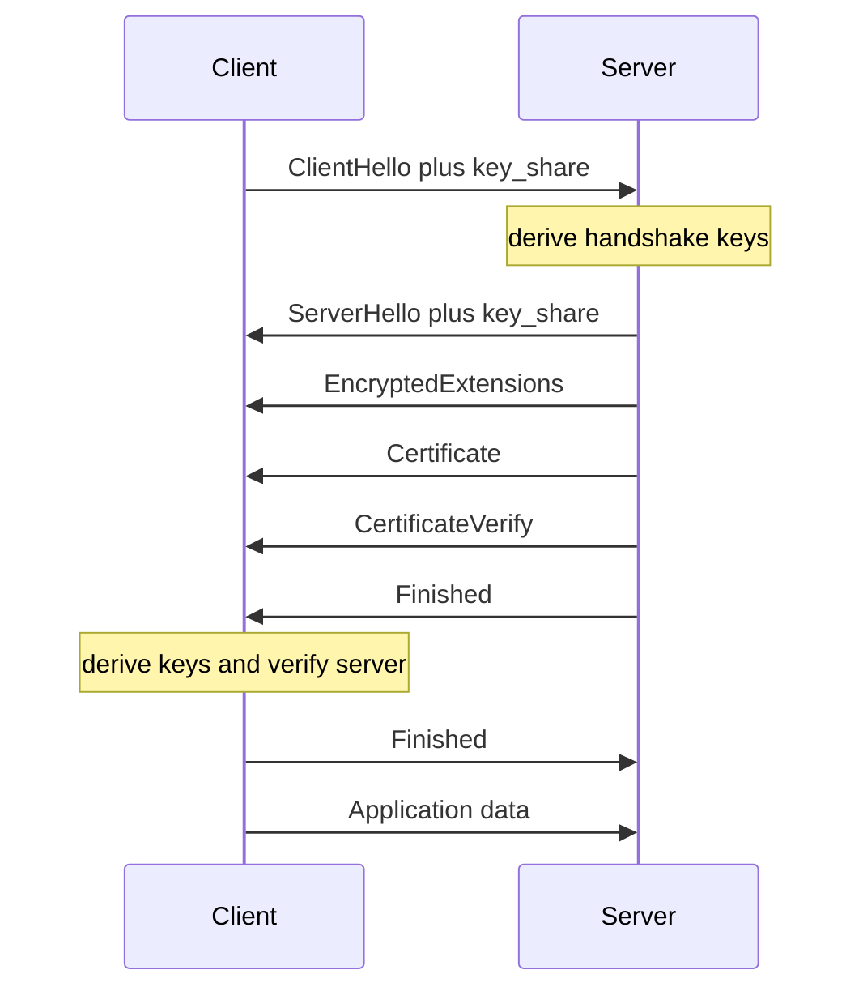
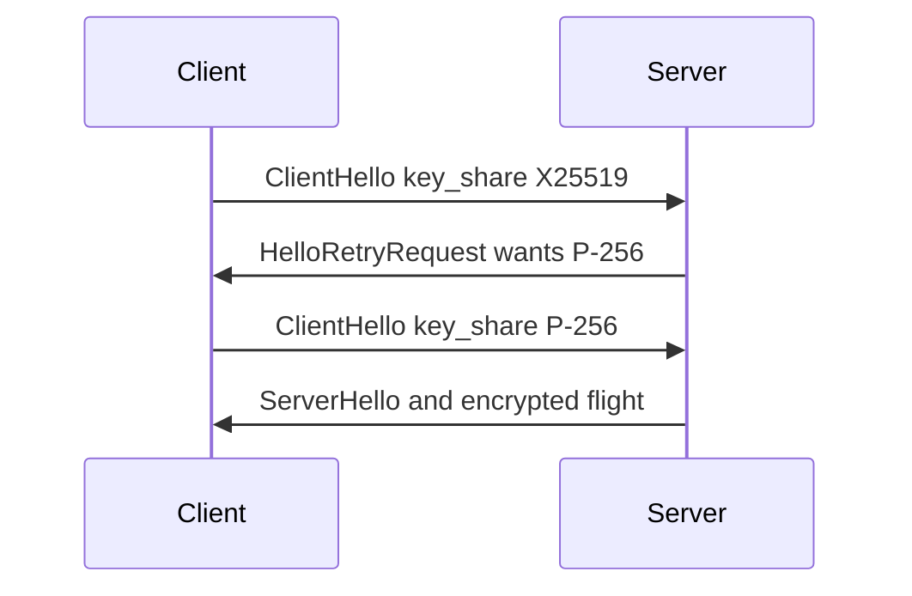
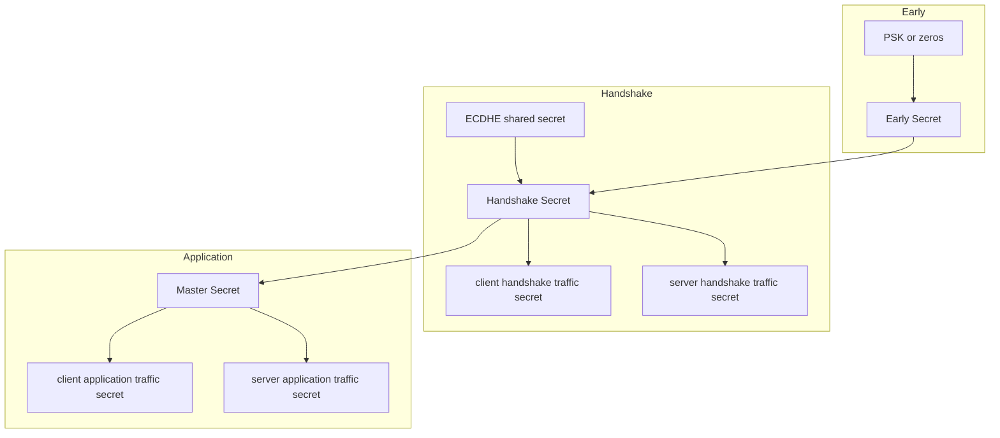

# The TLS 1.3 handshake
> One round trip, and where the keys come from

TLS 1.3 sets up an encrypted connection in a single round trip. We'll follow each message, see why one trip is enough, and trace every key back to one shared secret.
## The whole handshake



Here is the full exchange. The [client](#C) speaks first, the [server](#S) answers with a single flight of messages, and the client closes with its own Finished. After that, application data flows. Let's take the messages one at a time.
## ClientHello: the client guesses ahead {.build}

- **Random**: 32 fresh bytes that make every handshake unique
- **Cipher suites**: AEAD and hash pairs the client accepts, like AES-128-GCM with SHA-256
- **supported_groups**: key exchange curves it can use, like X25519
- **key_share**: an ephemeral public key for its preferred group, sent right now
- **SNI and ALPN**: which host name and which protocol, such as h2

The ClientHello opens with a [random](#random) value and a list of [cipher suites](#cipher-suites). It names the [groups](#supportedgroups) it supports. The key move is the [key share](#keyshare). Instead of asking which group the server wants, the client guesses, usually X25519, and sends an ephemeral public key immediately. Last come the [host name and protocol](#sni-and-alpn).

## ServerHello: the guess pays off

- **Random**: the server's own 32 bytes
- **Chosen suite**: one cipher suite from the client's list
- **key_share**: the server's ephemeral public key in the same group

The server picks a [suite](#chosen-suite) and answers with its own [key share](#keyshare). Now each side holds its private key and the other's public key, so both compute the same Diffie-Hellman secret. Everything the server sends after this point is encrypted.

<!-- revised clienthello-the-client-guesses-ahead -->
## ClientHello: the client guesses ahead {#clienthello-the-client-guesses-ahead .build}

- **Random**: 32 fresh bytes that make every handshake unique
- **Cipher suites**: AEAD and hash pairs the client accepts, like AES-128-GCM with SHA-256
- **supported_groups**: key exchange curves it can use, like X25519
- **key_share**: an ephemeral public key for its preferred group, sent right now
- **SNI and ALPN**: which host name and which protocol, such as h2

The ClientHello opens with a [random](#random) value and a list of [cipher suites](#cipher-suites). It names the [groups](#supported-groups) it supports. The key move is the [key share](#key-share). Instead of asking which group the server wants, the client guesses, usually X25519, and sends an ephemeral public key immediately. Last come the [host name and protocol](#sni-and-alpn).

<!-- revised serverhello-the-guess-pays-off -->
## ServerHello: the guess pays off {#serverhello-the-guess-pays-off}

- **Random**: the server's own 32 bytes
- **Chosen suite**: one cipher suite from the client's list
- **key_share**: the server's ephemeral public key in the same group

The server picks a [suite](#chosen-suite) and answers with its own [key share](#key-share). Now each side holds its private key and the other's public key, so both compute the same Diffie-Hellman secret. Everything the server sends after this point is encrypted.
## The encrypted server flight {.cards}

- **EncryptedExtensions** {#ee}: settings that don't affect key choice, like the agreed ALPN protocol
- **Certificate** {#cert}: the server's certificate chain, now hidden from eavesdroppers
- **CertificateVerify** {#cv}: a signature over the handshake transcript with the certificate's private key
- **Finished** {#sfin}: an HMAC over the transcript, keyed from the handshake secret

[EncryptedExtensions](#ee) carries leftover settings. The [Certificate](#cert) says who the server claims to be. [CertificateVerify](#cv) proves it: the server signs a hash of every message so far, which only the private key holder can do. [Finished](#sfin) is a MAC over the whole transcript, proving nobody tampered with any earlier message.

## The client finishes

> Client checks: certificate chain, CertificateVerify signature, server Finished MAC

The client validates the chain, checks the signature, and checks the server's Finished. Then it sends its own Finished, and can send application data in the very same flight. The server can even send data straight after its own Finished.

<!-- revised the-encrypted-server-flight -->
## The encrypted server flight {#the-encrypted-server-flight .cards}

- **EncryptedExtensions**: settings that don't affect key choice, like the agreed ALPN protocol
- **Certificate**: the server's certificate chain, now hidden from eavesdroppers
- **CertificateVerify**: a signature over the handshake transcript with the certificate's private key
- **Finished**: an HMAC over the transcript, keyed from the handshake secret

[EncryptedExtensions](#encryptedextensions) carries leftover settings. The [Certificate](#certificate) says who the server claims to be. [CertificateVerify](#certificateverify) proves it: the server signs a hash of every message so far, which only the private key holder can do. [Finished](#finished) is a MAC over the whole transcript, proving nobody tampered with any earlier message.
## Why one round trip is enough

| Step | TLS 1.2 | TLS 1.3 |
|---|---|---|
| Negotiate parameters | trip 1 | trip 1 |
| Key exchange | trip 2 | trip 1, speculative |
| Server authentication | plaintext, trip 1 | encrypted, trip 1 |
| First app data | after 2 RTT | after 1 RTT |

In TLS 1.2, the [first trip](#row-1) only agreed on algorithms, and the [key exchange](#row-2) needed a second trip. TLS 1.3 merges them: the client sends its key share up front, betting on a group. TLS 1.3 also trimmed the menu to a handful of strong groups, so the bet almost always wins. That's how the [first application data](#row-4) arrives after one round trip.

## When the guess misses



If the server doesn't support the client's guessed group, it replies with a [HelloRetryRequest](# "HelloRetryRequest") naming the group it wants. The client sends a [second ClientHello](# "key_share P-256") and the handshake costs two round trips. That's the worst case, and it's rare.
## Where the keys come from



Every key descends from one schedule built on HKDF. It starts with the [early secret](#ES), made from a pre-shared key if resuming, or zeros otherwise. Mixing in the [Diffie-Hellman shared secret](#DHE) gives the [handshake secret](#HS). From it come two traffic secrets, one per direction, that encrypt the [server's flight](#SHTS) and the [client's Finished](#CHTS). One more step gives the [master secret](#MS), and from that the [application traffic secrets](#CATS) for real data.

## Binding keys to the transcript

```math
\text{secret} = \text{HKDF-Expand-Label}(\text{parent},\ \text{label},\ \text{Hash}(\text{messages so far}))
```

Each derivation takes a parent secret, a label such as "s hs traffic", and a hash of the transcript so far. So the keys depend on every handshake message: if an attacker alters one byte of the ClientHello, both sides derive different keys and the Finished check fails. Because the Diffie-Hellman keys are ephemeral and thrown away, recorded traffic stays safe even if the server's certificate key leaks later. That's forward secrecy.

## Summary {.cards}

- **One flight each**: the client guesses a group and sends its key share up front
- **Encrypt early**: everything after ServerHello is encrypted, certificate included
- **Prove it**: CertificateVerify proves identity, Finished proves integrity
- **One key tree**: HKDF turns the ECDHE secret and transcript hashes into every key

To recap: the client [guesses ahead](#one-flight-each), so one round trip suffices. The server [encrypts](#encrypt-early) almost everything. Signatures and MACs [prove identity and integrity](#prove-it). And a [single key schedule](#one-key-tree) ties every key to the shared secret and the transcript.
