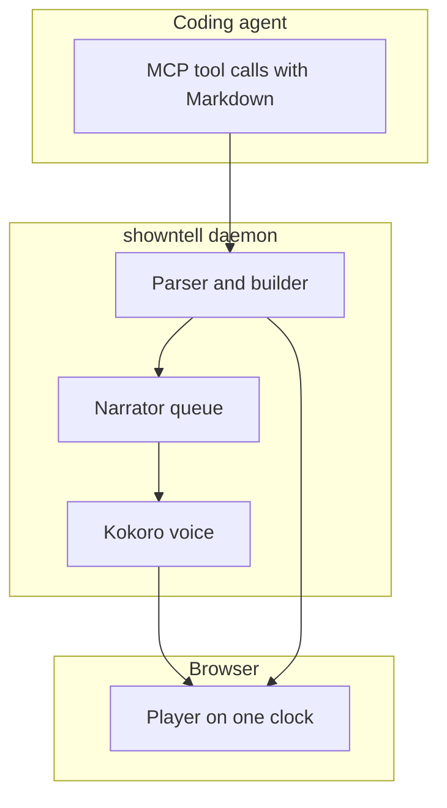

# A tour of showntell
> From an agent's Markdown to a narrated player

showntell turns Markdown written by a coding agent into a narrated slide walkthrough. We'll follow one walkthrough from the tool call to your speakers.
## Three parts



There are three parts. [The agent](#T) sends Markdown through MCP tools. [A local daemon](#B) parses it and [voices it with Kokoro](#K). And [the player](#P) in your browser plays it back.
## The opening comes back as a link

```python file=src/showntell/server.py lines=128-143
```

Every tool call lands in `_append`. On the first call, [it polls until the opening is voiced](#L130-134), usually a fraction of a second. Then [the reply tells the agent](#L141-143) to send the link right away. You start watching while the agent is still writing the body.

## Markdown becomes slides and narration

```python file=src/showntell/store.py lines=48-64
```

Inside the session, [the builder parses the new Markdown](#L58). Headings become slides, fenced blocks become visuals, and plain paragraphs become narration. Then [each new paragraph is sent off to be voiced](#L61-62), and [subscribers hear which slides changed](#L63). Problems, like a cue pointing at a missing line, go back to the agent [in the reply](#L64).
## One queue, in playing order

```python file=src/showntell/speech/narrator.py lines=92-104
```

The narrator is one worker thread with a priority queue. [A cached paragraph returns at once](#L94-98): the key is a hash of the model, voice, speed and spoken text, so nothing is voiced twice. [Two sessions asking for the same audio share one job](#L100-102). Otherwise [the job is queued by its position in the walkthrough](#L104), so earlier slides are always voiced first.

## Where the speech comes from

```python file=src/showntell/speech/__init__.py lines=12-26
```

The voice is Kokoro, an open eighty two million parameter model, running on your own machine. [On Apple silicon, auto picks MLX](#L15-16); [everywhere else it falls back to ONNX Runtime](#L19-22). There's also [a fake backend](#L23-25) for tests. Both real backends return the samples plus a start and end time for every word.
## Word times become cue times

```python file=src/showntell/speech/narrator.py lines=203-214
```

Those word times are what move the pointer. Each cue is a Markdown link in the narration, at a character offset. `cue_time` [finds the first word at or after that offset](#L208-209). If that word starts a new sentence, [the pointer moves a little early, into the pause](#L209 "LEAD_INTO_PAUSE"), so your eyes arrive before the voice does.

## Changes stream to the browser

```python file=src/showntell/server.py lines=333-350
```

The player opens a server sent event stream. [It first gets the whole walkthrough](#L336). After that, [bursts of changes are merged](#L343-347), and [only the changed slides are sent](#L348). So a slide whose audio just finished arrives on its own.
## The player runs on one clock

```javascript file=src/showntell/static/js/timeline.js lines=16-37
```

In the browser, `build` lays every paragraph end to end on a single timeline. [Voiced paragraphs use their real duration](#L28); unvoiced ones get an estimate from the word count. [A segment is ready](#L30) once its audio exists, and the player waits there if it catches up with the writer. Everything on screen, the slide, the pointer and the caption, is a pure function of that clock time.

## Recap {.build}

- **Server**: `server.py` holds the MCP tools and returns the link early {#server}
- **Builder**: `store.py` and `build.py` turn Markdown into slides and checks {#builder}
- **Narrator**: `narrator.py` queues, caches and times every paragraph {#narrator}
- **Player**: `timeline.js` and `main.js` play it all on one clock {#player}

To recap: [the server](#server) gets the link out early. [The builder](#builder) turns Markdown into slides and checks them. [The narrator](#narrator) voices each paragraph locally with Kokoro. And [the player](#player) puts it together, word by word.

<!-- revised the-player-runs-on-one-clock -->
## The player runs on one clock {#the-player-runs-on-one-clock}

```javascript file=src/showntell/static/js/timeline.js lines=19-36
```

In the browser, `build` lays every paragraph end to end on a single timeline. [Voiced paragraphs use their real duration](#L29); unvoiced ones get an estimate from the word count. [A segment is ready](#L31) once its audio exists, and the player waits there if it catches up with the writer. Everything on screen, the slide, the pointer and the caption, is a pure function of that clock time.
