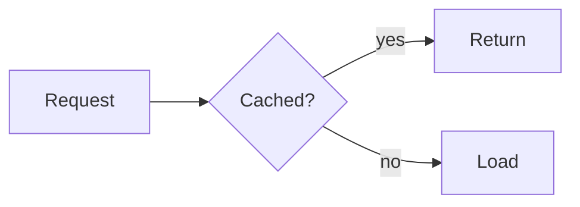

# Every slide kind
> A tour of what the player draws

This opening sentence is narrated while the title shows.

## Code from disk {#code .build}

```python file=src/showntell/format.py lines=1-14
```

The file opens with [a docstring](#L1) and then [imports](#L8 "import re").

## A change {#diff}

```python old
total = 0
for x in xs:
    total += x
```
```python new
total = sum(xs)
```

The loop [goes away](#-L2) and [one call](#+L1 "sum") replaces it.

## Flow {#flow .build}



A [request](#a) checks [the cache](#b) and either [returns](#c) or [loads](#d).

## Steps {#steps .build}

1. **Parse**: text to blocks {#parse}
2. **Build**: blocks to slides {#build}
3. **Voice**: slides to audio {#voice}

First we [parse](#parse), then [build](#build), then [voice](#voice).

## Options {#cards .cards}

- **Memory**: fast, lost on restart {#mem}
- **Disk**: slower, survives restarts {#disk}
- **Network**: shared between machines {#net}

[Memory](#mem) is fastest and [the network](#net) is shared.

## Checks {#table}

| Check | When |
|---|---|
| Cue target | every call |
| Pacing | slide end |

[Cue targets](#row-1) are checked on every call.

## Softmax {#math}

```math
\mathrm{softmax}(z)_i = \frac{e^{z_i}}{\sum_j e^{z_j}}
```

Each output is [an exponential](#) divided by the sum of all of them.

## Plain words {#text}

> Shown text, not spoken.

A slide with only words on it.
