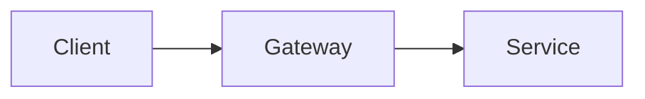

# More kinds

The newer visuals.

## Part one {#part .chapter}
> Code

## Evolving {#evolve}

```python step
def total(xs):
    t = 0
    for x in xs:
        t += x
    return t
```
```python step
def total(xs):
    return sum(xs)
```

The loop [adds each value](#L4). Then it [becomes one call](#step-2) and [sum does the work](#L2 "sum").

## Long {#long}

```python file=tests/js/golden/files/long.py lines=1-150 scroll
```

First [the imports](#L9). Much later, [this line](#L140).

## Path {#path}



A request goes [all the way through](#c->g->s) and the [gateway](#g){.circle} checks it.

## Numbers {#numbers}

```stat
p95 latency: 400 ms -> 100 ms
```

The [p95 latency](#p95-latency) fell by three quarters, which took a lot of patient work over many weeks.

## Screen {#screen}

{frame=browser url="example.com"}

The [top left](#@0,0,50,40){.zoom} is where it starts.

## Ship {#ship}

- [x] **Tests**: pass {#tests}
- [ ] **Announce**: later {#announce}

The [tests](#tests) pass, and the [announcement](#announce) waits.
