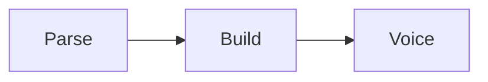

# Steps, revealed
> one paragraph per step

Three stages turn text into a talk.

## Pipeline {#pipe .build}



Text is [parsed](#parse) first.

Then the blocks are [built](#build) into slides.

Finally each slide is [voiced](#voice).

{pause=1}

## Code {#code .build}

```python start=10
def get(self, key):
    if key in self._data:
        return self._data[key]
    value = self.loader(key)
    return value
```

The method [checks the cache](#L11 "if key in self._data") and [returns a hit](#L12).

On a miss it [calls the loader](#L13).
